# Исследование характеристик жилой недвижимости методами машинного обучения

## Введение

Машинное обучение позволяет исследовать закономерности на рынке недвижимости, сопоставлять подходы к прогнозированию стоимости и изучать группы объектов со сходными характеристиками. При этом качество решения зависит не только от выбранного алгоритма, но и от подготовки признаков, способа проверки моделей и корректности интерпретации результатов.

**Цель исследования** состоит в сравнении методов машинного обучения для прогнозирования стоимости домов, определения ценовой категории и поиска групп похожих объектов по данным об исторических продажах недвижимости.

В качестве источника выбран [House Prices - Advanced Regression Techniques](https://www.kaggle.com/competitions/house-prices-advanced-regression-techniques/data), основанный на данных о продаже жилых домов в городе Эймс, штат Айова. В исходной обучающей части набора представлены 1 460 наблюдений и 81 столбец, включая идентификатор и цену продажи `SalePrice`.

В ходе работы решаются следующие задачи. Сначала исследуются состав, качество и распределения данных. Затем выполняются обработка пропусков, ограничение крайних значений, кодирование категорий и создание дополнительных характеристик. Далее сравниваются модели регрессии и классификации с проверкой качества на одинаковых разбиениях. Отдельно оцениваются значимость признаков и объяснения прогнозов. Завершает исследование кластеризация домов без использования их цены при построении групп.

Работа соответствует составу задач уровня «5» методического задания. Для воспроизводимости расчётов используется единая Python-реализация. Численные результаты относятся к зафиксированным экспериментам и не предполагают, что повторное обучение с другими версиями библиотек даст побитовое совпадение.

## Перечень условных обозначений

| Обозначение | Значение |
|---|---|
| `Id` | Идентификатор записи о доме, не используется как предиктор |
| `SalePrice` | Фактическая цена продажи недвижимости |
| `PriceClass` | Бинарный ценовой класс. Значение 1 соответствует цене от 200 000 USD |
| USD | Доллар США, единица измерения цены и абсолютных ошибок регрессии |
| EDA (Exploratory Data Analysis) | Разведочный анализ данных |
| IQR (Interquartile Range) | Межквартильный размах |
| OHE (One-Hot Encoding) | Кодирование номинальных категорий отдельными индикаторами |
| CV (Cross-Validation) | Кросс-валидация, проверка модели на нескольких разбиениях |
| OOF (Out-of-Fold) | Прогноз для объекта, полученный моделью, не обучавшейся на нём в данном фолде |
| MAE (Mean Absolute Error) | Средняя абсолютная ошибка регрессии |
| RMSE (Root Mean Squared Error) | Корень из средней квадратичной ошибки регрессии |
| R² | Коэффициент детерминации |
| Precision, Recall, F1 | Точность положительных решений, полнота и их гармоническое среднее |
| ROC-AUC | Площадь под ROC-кривой, показатель способности ранжировать классы |
| VIF (Variance Inflation Factor) | Коэффициент инфляции дисперсии для оценки линейной взаимозависимости признаков |
| PCA (Principal Component Analysis) | Метод главных компонент |
| MLP (Multilayer Perceptron) | Многослойный персептрон |
| SHAP (SHapley Additive exPlanations) | Аддитивные объяснения модельного прогноза по значениям Шепли |
| K-means | Метод кластеризации k-средних |
| t-SNE | Метод нелинейной двумерной визуализации локальных соседств |
| DBSCAN | Алгоритм кластеризации по плотности |

## 1. Разведочный анализ House Prices

**Цель исследования** заключается в том, чтобы изучить структуру и качество набора данных Ames Housing, выполнить EDA и сформулировать задачи регрессии, классификации и кластеризации.

Источник - [House Prices - Advanced Regression Techniques](https://www.kaggle.com/competitions/house-prices-advanced-regression-techniques/data).

Данные используются локально после принятия условий Kaggle. Этот Notebook не выводит исходные строки набора и не содержит сам `train.csv`. Для его выполнения необходимо запустить Jupyter из корня репозитория.

### Загрузка и первичное исследование

Загружаем оригинальный `data/raw/train.csv` без его изменения. Отдельно проверяем количество объектов, типы данных, дубликаты и пропуски. Результаты строятся функциями пакета `house_prices_ai`, чтобы избежать дублирования кода.

<details>
<summary>Код ячейки 3</summary>

```python
from IPython.display import display, Image
from pathlib import Path
import sys

# PyCharm может запускать Notebook как из корня репозитория, так и из notebooks/.
root = Path.cwd()
if not (root / "house_prices_ai").is_dir():
    root = root.parent
if not (root / "house_prices_ai").is_dir():
    raise FileNotFoundError("Не найдён корень проекта house-prices-ai")
if str(root) not in sys.path:
    sys.path.insert(0, str(root))

from house_prices_ai.eda import run_eda, HIGH_PRICE_THRESHOLD
from house_prices_ai.config import RAW_TRAIN_FILE, OUTPUT_DIR

result = run_eda(RAW_TRAIN_FILE, OUTPUT_DIR / "eda")
print(f"Наблюдений: {result.observations}; столбцов: {result.columns}")
print(f"Числовых: {result.numeric_columns}; текстовых: {result.categorical_columns}")
print(f"Пропусков: {result.missing_total}")
print(f"Полных дубликатов: {result.duplicate_rows}")
print(f"Дубликатов без Id: {result.duplicate_feature_rows}")
print(f"Повторов Id: {result.duplicate_ids}")
print(f"Локальный отчёт: {result.report_path}")
```

</details>

```text
Наблюдений: 1460; столбцов: 81
Числовых: 38; текстовых: 43
Пропусков: 6965
Полных дубликатов: 0
Дубликатов без Id: 0
Повторов Id: 0
Локальный отчёт: outputs/eda/lr01_eda_summary.md
```

<details>
<summary>Код ячейки 4</summary>

```python
display(result.dictionary)
print("Столбцы с пропусками:")
display(result.missing)
```

</details>

|  | Признак | Описание | Тип данных | Роль | Пропуски | Пропуски, % | Уникальных значений |
| --- | --- | --- | --- | --- | --- | --- | --- |
| 0 | Id | Уникальный идентификатор объекта (не признак н... | int64 | Идентификатор | 0 | 0.00 | 1460 |
| 1 | MSSubClass | Код типа жилого строения (категориальный код) | int64 | Категориальный код (хранится числом) | 0 | 0.00 | 15 |
| 2 | MSZoning | Категория территориального зонирования | object | Категориальный признак | 0 | 0.00 | 5 |
| 3 | LotFrontage | Протяжённость участка вдоль улицы, футы | float64 | Числовой признак | 259 | 17.74 | 110 |
| 4 | LotArea | Площадь земельного участка, кв. футы | int64 | Числовой признак | 0 | 0.00 | 1073 |
| ... | ... | ... | ... | ... | ... | ... | ... |
| 76 | MoSold | Месяц продажи | int64 | Числовой признак | 0 | 0.00 | 12 |
| 77 | YrSold | Год продажи | int64 | Числовой признак | 0 | 0.00 | 5 |
| 78 | SaleType | Тип сделки продажи | object | Категориальный признак | 0 | 0.00 | 9 |
| 79 | SaleCondition | Условия продажи | object | Категориальный признак | 0 | 0.00 | 6 |
| 80 | SalePrice | Фактическая цена продажи недвижимости, доллары... | int64 | Целевая переменная регрессии | 0 | 0.00 | 663 |

```text
Столбцы с пропусками:
```

|  | Признак | Пропуски | Доля, % |
| --- | --- | --- | --- |
| 0 | PoolQC | 1453 | 99.52 |
| 1 | MiscFeature | 1406 | 96.30 |
| 2 | Alley | 1369 | 93.77 |
| 3 | Fence | 1179 | 80.75 |
| 4 | FireplaceQu | 690 | 47.26 |
| 5 | LotFrontage | 259 | 17.74 |
| 6 | GarageCond | 81 | 5.55 |
| 7 | GarageFinish | 81 | 5.55 |
| 8 | GarageQual | 81 | 5.55 |
| 9 | GarageType | 81 | 5.55 |
| 10 | GarageYrBlt | 81 | 5.55 |
| 11 | BsmtExposure | 38 | 2.60 |
| 12 | BsmtFinType2 | 38 | 2.60 |
| 13 | BsmtCond | 37 | 2.53 |
| 14 | BsmtFinType1 | 37 | 2.53 |
| 15 | BsmtQual | 37 | 2.53 |
| 16 | MasVnrArea | 8 | 0.55 |
| 17 | MasVnrType | 8 | 0.55 |
| 18 | Electrical | 1 | 0.07 |

Пропущенные значения не всегда означают, что информация потеряна. Например, отсутствие записи в `PoolQC` (качество бассейна), `Alley` (тип подъездной аллеи) или `GarageType` (тип гаража) может указывать, что у дома нет соответствующего объекта. При предобработке данных необходимо учитывать смысл каждого признака, а не заменять все пропуски одним способом.

Таблицы 1.1 и 1.2 - описание полей исходного набора и распределение пропусков.

Таблицы содержат русские названия и описания 81 столбца, типы данных и доли пропусков. В пояснительной записке полный перечень удобно разместить в приложении.

### Описательная статистика

Для числовых характеристик рассматриваем минимум, максимум, квартили, медиану, среднее и стандартное отклонение. Дополнительно рассматриваем асимметрию и эксцесс распределений.

<details>
<summary>Код ячейки 7</summary>

```python
display(result.numeric_summary)
print("Наиболее асимметричные числовые признаки:")
display(result.skewness.abs().sort_values(ascending=False).head(12).to_frame("|Асимметрия|") )
print("Признаки с наибольшим по модулю эксцессом:")
display(result.kurtosis.abs().sort_values(ascending=False).head(12).to_frame("|Эксцесс|") )
```

</details>

|  | count | mean | std | min | 25% | 50% | 75% | max |
| --- | --- | --- | --- | --- | --- | --- | --- | --- |
| MSSubClass | 1460.0 | 56.897260 | 42.300571 | 20.0 | 20.00 | 50.0 | 70.00 | 190.0 |
| LotFrontage | 1201.0 | 70.049958 | 24.284752 | 21.0 | 59.00 | 69.0 | 80.00 | 313.0 |
| LotArea | 1460.0 | 10516.828082 | 9981.264932 | 1300.0 | 7553.50 | 9478.5 | 11601.50 | 215245.0 |
| OverallQual | 1460.0 | 6.099315 | 1.382997 | 1.0 | 5.00 | 6.0 | 7.00 | 10.0 |
| OverallCond | 1460.0 | 5.575342 | 1.112799 | 1.0 | 5.00 | 5.0 | 6.00 | 9.0 |
| YearBuilt | 1460.0 | 1971.267808 | 30.202904 | 1872.0 | 1954.00 | 1973.0 | 2000.00 | 2010.0 |
| YearRemodAdd | 1460.0 | 1984.865753 | 20.645407 | 1950.0 | 1967.00 | 1994.0 | 2004.00 | 2010.0 |
| MasVnrArea | 1452.0 | 103.685262 | 181.066207 | 0.0 | 0.00 | 0.0 | 166.00 | 1600.0 |
| BsmtFinSF1 | 1460.0 | 443.639726 | 456.098091 | 0.0 | 0.00 | 383.5 | 712.25 | 5644.0 |
| BsmtFinSF2 | 1460.0 | 46.549315 | 161.319273 | 0.0 | 0.00 | 0.0 | 0.00 | 1474.0 |
| BsmtUnfSF | 1460.0 | 567.240411 | 441.866955 | 0.0 | 223.00 | 477.5 | 808.00 | 2336.0 |
| TotalBsmtSF | 1460.0 | 1057.429452 | 438.705324 | 0.0 | 795.75 | 991.5 | 1298.25 | 6110.0 |
| 1stFlrSF | 1460.0 | 1162.626712 | 386.587738 | 334.0 | 882.00 | 1087.0 | 1391.25 | 4692.0 |
| 2ndFlrSF | 1460.0 | 346.992466 | 436.528436 | 0.0 | 0.00 | 0.0 | 728.00 | 2065.0 |
| LowQualFinSF | 1460.0 | 5.844521 | 48.623081 | 0.0 | 0.00 | 0.0 | 0.00 | 572.0 |
| GrLivArea | 1460.0 | 1515.463699 | 525.480383 | 334.0 | 1129.50 | 1464.0 | 1776.75 | 5642.0 |
| BsmtFullBath | 1460.0 | 0.425342 | 0.518911 | 0.0 | 0.00 | 0.0 | 1.00 | 3.0 |
| BsmtHalfBath | 1460.0 | 0.057534 | 0.238753 | 0.0 | 0.00 | 0.0 | 0.00 | 2.0 |
| FullBath | 1460.0 | 1.565068 | 0.550916 | 0.0 | 1.00 | 2.0 | 2.00 | 3.0 |
| HalfBath | 1460.0 | 0.382877 | 0.502885 | 0.0 | 0.00 | 0.0 | 1.00 | 2.0 |
| BedroomAbvGr | 1460.0 | 2.866438 | 0.815778 | 0.0 | 2.00 | 3.0 | 3.00 | 8.0 |
| KitchenAbvGr | 1460.0 | 1.046575 | 0.220338 | 0.0 | 1.00 | 1.0 | 1.00 | 3.0 |
| TotRmsAbvGrd | 1460.0 | 6.517808 | 1.625393 | 2.0 | 5.00 | 6.0 | 7.00 | 14.0 |
| Fireplaces | 1460.0 | 0.613014 | 0.644666 | 0.0 | 0.00 | 1.0 | 1.00 | 3.0 |
| GarageYrBlt | 1379.0 | 1978.506164 | 24.689725 | 1900.0 | 1961.00 | 1980.0 | 2002.00 | 2010.0 |
| GarageCars | 1460.0 | 1.767123 | 0.747315 | 0.0 | 1.00 | 2.0 | 2.00 | 4.0 |
| GarageArea | 1460.0 | 472.980137 | 213.804841 | 0.0 | 334.50 | 480.0 | 576.00 | 1418.0 |
| WoodDeckSF | 1460.0 | 94.244521 | 125.338794 | 0.0 | 0.00 | 0.0 | 168.00 | 857.0 |
| OpenPorchSF | 1460.0 | 46.660274 | 66.256028 | 0.0 | 0.00 | 25.0 | 68.00 | 547.0 |
| EnclosedPorch | 1460.0 | 21.954110 | 61.119149 | 0.0 | 0.00 | 0.0 | 0.00 | 552.0 |
| 3SsnPorch | 1460.0 | 3.409589 | 29.317331 | 0.0 | 0.00 | 0.0 | 0.00 | 508.0 |
| ScreenPorch | 1460.0 | 15.060959 | 55.757415 | 0.0 | 0.00 | 0.0 | 0.00 | 480.0 |
| PoolArea | 1460.0 | 2.758904 | 40.177307 | 0.0 | 0.00 | 0.0 | 0.00 | 738.0 |
| MiscVal | 1460.0 | 43.489041 | 496.123024 | 0.0 | 0.00 | 0.0 | 0.00 | 15500.0 |
| MoSold | 1460.0 | 6.321918 | 2.703626 | 1.0 | 5.00 | 6.0 | 8.00 | 12.0 |
| YrSold | 1460.0 | 2007.815753 | 1.328095 | 2006.0 | 2007.00 | 2008.0 | 2009.00 | 2010.0 |
| SalePrice | 1460.0 | 180921.195890 | 79442.502883 | 34900.0 | 129975.00 | 163000.0 | 214000.00 | 755000.0 |

```text
Наиболее асимметричные числовые признаки:
```

|  | \|Асимметрия\| |
| --- | --- |
| MiscVal | 24.476794 |
| PoolArea | 14.828374 |
| LotArea | 12.207688 |
| 3SsnPorch | 10.304342 |
| LowQualFinSF | 9.011341 |
| KitchenAbvGr | 4.488397 |
| BsmtFinSF2 | 4.255261 |
| ScreenPorch | 4.122214 |
| BsmtHalfBath | 4.103403 |
| EnclosedPorch | 3.089872 |
| MasVnrArea | 2.669084 |
| OpenPorchSF | 2.364342 |

```text
Признаки с наибольшим по модулю эксцессом:
```

|  | \|Эксцесс\| |
| --- | --- |
| MiscVal | 701.003342 |
| PoolArea | 223.268499 |
| LotArea | 203.243271 |
| 3SsnPorch | 123.662379 |
| LowQualFinSF | 83.234817 |
| KitchenAbvGr | 21.532404 |
| BsmtFinSF2 | 20.113338 |
| ScreenPorch | 18.439068 |
| LotFrontage | 17.452867 |
| BsmtHalfBath | 16.396642 |
| TotalBsmtSF | 13.250483 |
| BsmtFinSF1 | 11.118236 |

Таблицы 1.3-1.5 - описательная статистика, асимметрия и эксцесс числовых признаков. Они помогают выделить признаки с несимметричными распределениями для дальнейшей визуализации.

### Визуализация распределений и анализ выбросов

Графики рассматриваются по группам признаков. После каждой группы сформулированы общие наблюдения.

#### Гистограммы числовых характеристик

<details>
<summary>Код ячейки 10</summary>

```python
if "histograms_01" in result.plots:
    display(Image(filename=str(result.plots["histograms_01"])))
```

</details>

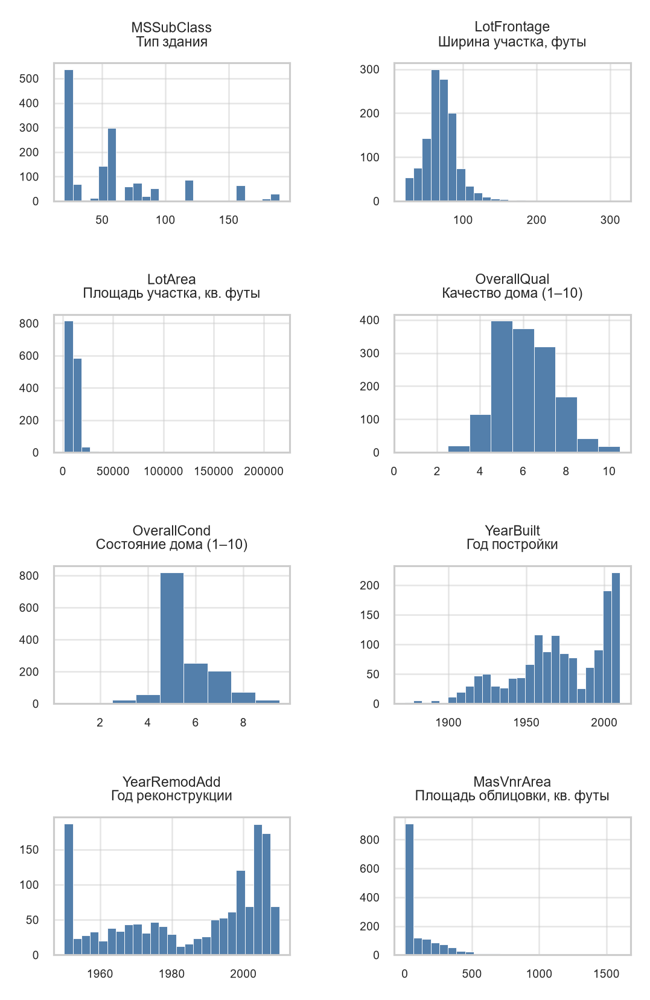

*Рисунок 1.1 - Тип застройки, площадь участка и качество дома.*

На этих гистограммах показаны тип строения, размеры участка, качество и возраст дома. Значения `MSSubClass` (тип здания) записаны числами, но обозначают категории. Разница между кодами не соответствует пропорциональному различию домов. `LotArea` (площадь участка) и `MasVnrArea` (площадь каменной облицовки) распределены неравномерно. Большинство объектов имеет сравнительно небольшие значения, а крупные встречаются реже. `OverallQual` (общее качество дома) и `OverallCond` (общее состояние дома) оцениваются по дискретным шкалам. При дальнейшей обработке нужно учитывать, какие признаки являются кодами категорий, а какие - настоящими числовыми величинами.

<details>
<summary>Код ячейки 12</summary>

```python
if "histograms_02" in result.plots:
    display(Image(filename=str(result.plots["histograms_02"])))
```

</details>

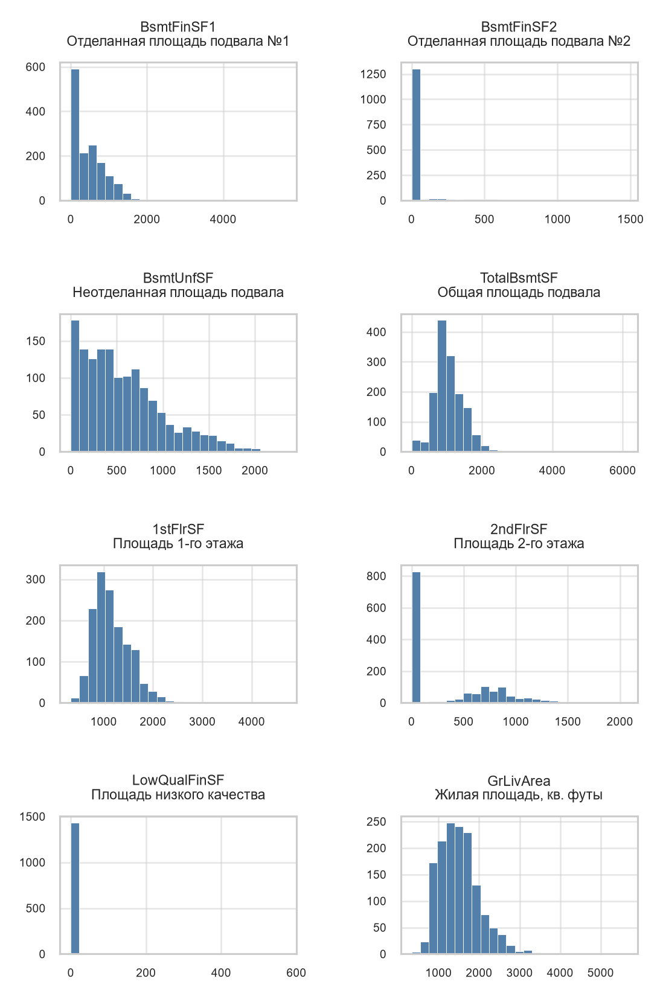

*Рисунок 1.2 - Площади подвала и жилых этажей.*

У многих домов отсутствуют отдельные виды помещений. Поэтому нулевые значения `BsmtFinSF2` (отделанная площадь подвала второго типа), `2ndFlrSF` (площадь второго этажа) и `LowQualFinSF` (площадь помещений низкого качества) могут быть вполне корректными. Для `TotalBsmtSF` (общая площадь подвала) и `GrLivArea` (общая жилая площадь) заметен значительный разброс. Некоторые дома просторнее большинства. При предобработке необходимо различать настоящие пропуски, отсутствие объекта (ноль) и необычно большие, но возможные значения.

<details>
<summary>Код ячейки 14</summary>

```python
if "histograms_03" in result.plots:
    display(Image(filename=str(result.plots["histograms_03"])))
```

</details>

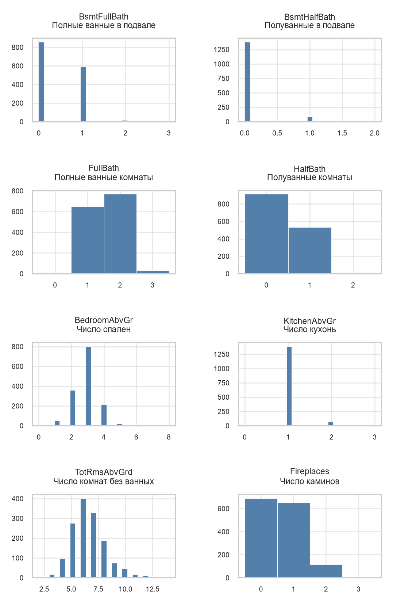

*Рисунок 1.3 - Ванные, спальни, комнаты и камины.*

Количество спален, ванных комнат и каминов не может принимать произвольные дробные значения, поэтому на графиках видны отдельные столбцы для целых чисел. Например, `BedroomAbvGr` (количество спален), `KitchenAbvGr` (количество кухонь) и `Fireplaces` (количество каминов) - счётные признаки. Нулевое значение часто просто означает отсутствие соответствующего помещения или оборудования. При подготовке моделей важно сохранить этот смысл и не требовать от таких распределений сходства с непрерывным нормальным распределением.

<details>
<summary>Код ячейки 16</summary>

```python
if "histograms_04" in result.plots:
    display(Image(filename=str(result.plots["histograms_04"])))
```

</details>

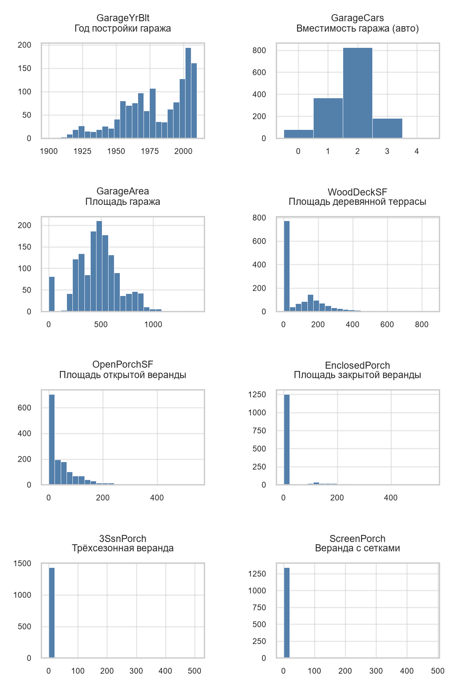

*Рисунок 1.4 - Гараж, террасы и крыльцо.*

`GarageCars` (вместимость гаража в автомобилях) и `GarageArea` (площадь гаража) описывают связанные свойства. Более просторный гараж, как правило, вмещает больше автомобилей. У `WoodDeckSF` (площадь деревянной террасы) и `OpenPorchSF` (площадь открытого крыльца) часто встречается ноль, поскольку такие элементы есть не у каждого дома. В дальнейшем проверим взаимосвязь гаражных характеристик и будем отдельно учитывать признаки, отражающие отсутствие дополнительных построек.

<details>
<summary>Код ячейки 18</summary>

```python
if "histograms_05" in result.plots:
    display(Image(filename=str(result.plots["histograms_05"])))
```

</details>

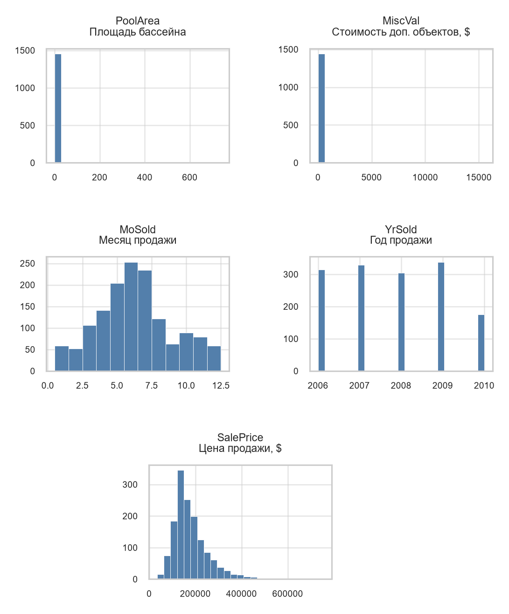

*Рисунок 1.5 - Редкие объекты, дата и цена продажи.*

`PoolArea` (площадь бассейна) и `MiscVal` (стоимость дополнительных объектов) у большинства домов равны нулю. Бассейны и дополнительные постройки встречаются редко. `MoSold` (месяц продажи) и `YrSold` (год продажи) характеризуют дату сделки. Распределение `SalePrice` (цена продажи) имеет длинный правый хвост. Дорогие дома встречаются редко, но повышают среднюю цену. При оценке регрессионных моделей важно отдельно рассмотреть ошибки прогнозирования для дорогих объектов.

**Общий вывод по рисункам 1.1-1.5.** Числовые, категориальные и счётные признаки имеют разные распределения. Нули нередко отражают отсутствие элемента дома, а правые хвосты связаны с редкими крупными объектами. Это необходимо учитывать при предобработке.

#### Диаграммы размаха (boxplot)

Линия внутри прямоугольника обозначает медиану, а его края соответствуют Q1 и Q3. «Усы» обычно ограничены правилом 1,5 межквартильного размаха. Чёрные точки показывают значения за пределами «усов». Это **потенциальные**, а не доказанные ошибки данных.

<details>
<summary>Код ячейки 22</summary>

```python
if "boxplots_01" in result.plots:
    display(Image(filename=str(result.plots["boxplots_01"])))
```

</details>

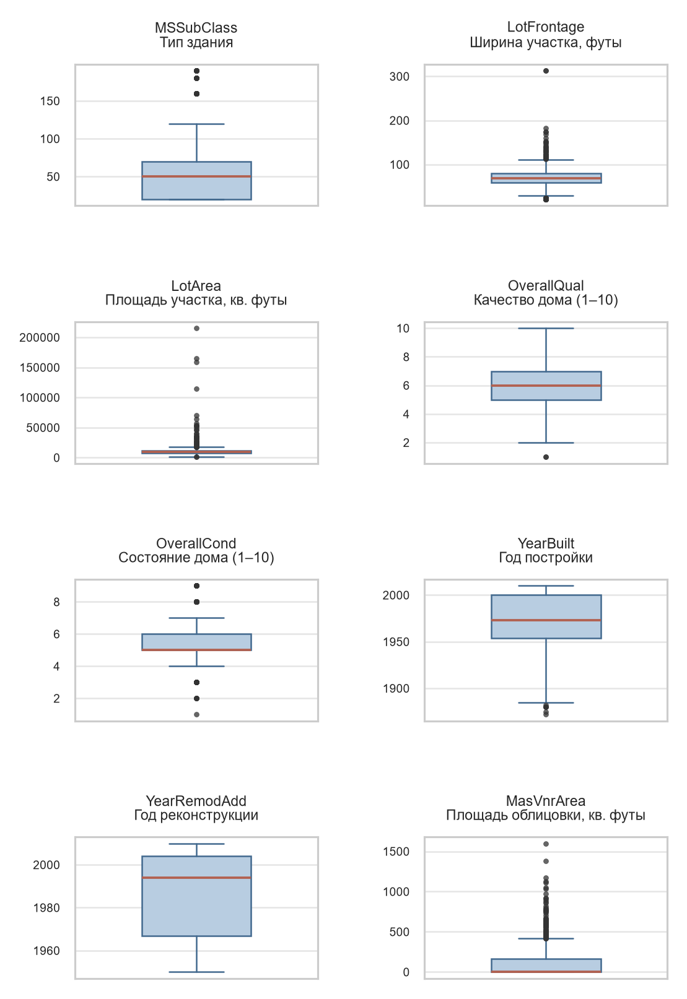

*Рисунок 1.6 - Выбросы в характеристиках участка и качества.*

На диаграммах размаха видны медиана, диапазон основной массы значений и отдельные точки за пределами «усов» (1,5 межквартильного размаха). Для `LotArea` (площадь участка) и `LotFrontage` (протяжённость границы участка вдоль улицы) такие точки могут соответствовать редким крупным участкам. `MSSubClass` (тип здания) и шкалы качества являются дискретными, поэтому значение за пределами «усов» не обязательно означает ошибку. На этом этапе необычные наблюдения не удаляются автоматически. Сначала необходимо проверить их достоверность.

<details>
<summary>Код ячейки 24</summary>

```python
if "boxplots_02" in result.plots:
    display(Image(filename=str(result.plots["boxplots_02"])))
```

</details>

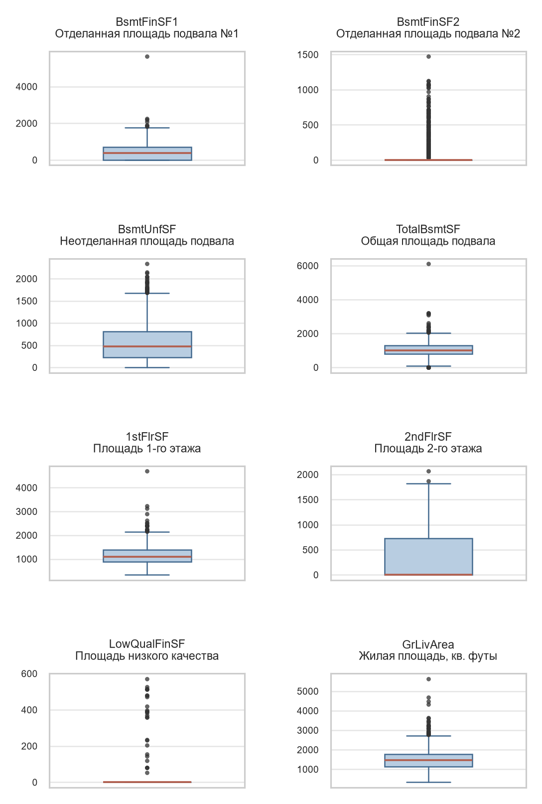

*Рисунок 1.7 - Выбросы в площадях подвала и жилых этажей.*

Большая площадь подвала, этажа или жилых помещений может быть естественной особенностью крупного дома. Например, при оценке `TotalBsmtSF` (общая площадь подвала) и `GrLivArea` (общая жилая площадь) важно сопоставлять необычные значения с ценой и площадями остальных помещений. Механическое удаление всех точек за пределами «усов» привело бы к потере редких, но потенциально достоверных объектов. При предобработке проверим такие записи по нескольким взаимосвязанным признакам.

<details>
<summary>Код ячейки 26</summary>

```python
if "boxplots_03" in result.plots:
    display(Image(filename=str(result.plots["boxplots_03"])))
```

</details>

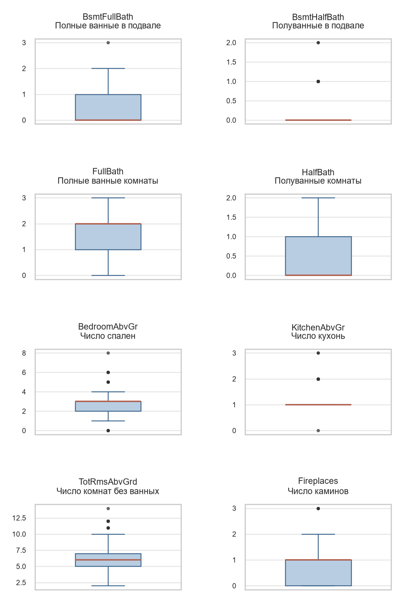

*Рисунок 1.8 - Распределение числа помещений и каминов.*

Число комнат, ванных и каминов измеряется целыми значениями. У `FullBath` (число полноценных ванных комнат), `BedroomAbvGr` (количество спален) и `Fireplaces` (количество каминов) редкие большие значения могут отображаться отдельными точками. Это ещё не означает, что сведения ошибочны. В дальнейшем необходимо проверять правдоподобие значений и их согласованность с характеристиками конкретного дома, а не автоматически отсекать всё необычное.

<details>
<summary>Код ячейки 28</summary>

```python
if "boxplots_04" in result.plots:
    display(Image(filename=str(result.plots["boxplots_04"])))
```

</details>

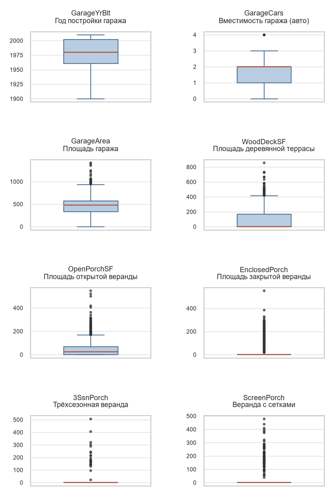

*Рисунок 1.9 - Необычные размеры гаража, террас и крыльца.*

В распределениях площадей гаража, террасы и крыльца часто встречаются нули и отдельные крупные значения. Например, у `GarageArea` (площадь гаража) редкие большие объекты могут быть реальными, а `WoodDeckSF` (площадь деревянной террасы) у домов без террасы закономерно равен нулю. При обработке данных сравним `GarageArea` (площадь гаража) с `GarageCars` (вместимость гаража), чтобы найти возможные несоответствия.

<details>
<summary>Код ячейки 30</summary>

```python
if "boxplots_05" in result.plots:
    display(Image(filename=str(result.plots["boxplots_05"])))
```

</details>

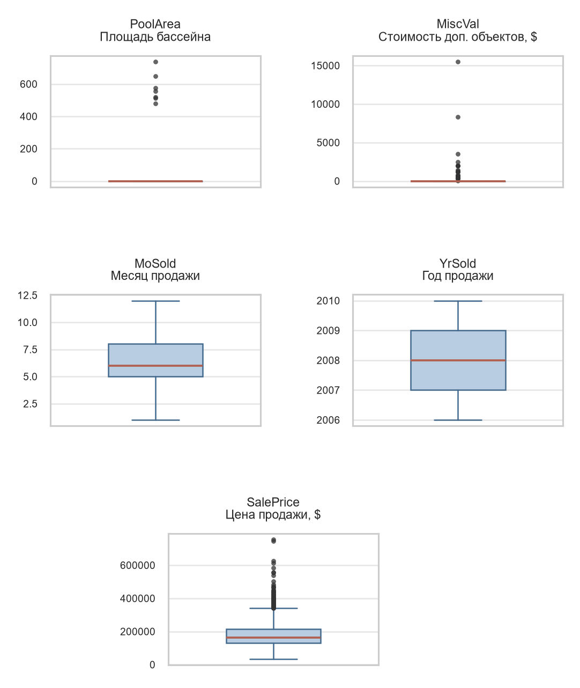

*Рисунок 1.10 - Цена продажи и редкие дополнительные объекты.*

Для `SalePrice` (цена продажи) видны отдельные дорогие дома за пределами верхнего «уса». Это потенциальные статистические выбросы, но не обязательно ошибки исходных данных. У `PoolArea` (площадь бассейна) и `MiscVal` (стоимость дополнительных объектов) межквартильный размах может оказаться равным нулю из-за большого количества нулей. При сравнении моделей особенно важно учитывать крупные ошибки для дорогих домов.

**Общий вывод по рисункам 1.6-1.10.** Точки за пределами «усов» не являются автоматическим основанием для удаления домов. Необходимо различать ошибки данных, реальные редкие объекты и признаки с множеством нулевых значений.

#### Распределение цены продажи

<details>
<summary>Код ячейки 33</summary>

```python
display(Image(filename=str(result.plots["target"])))
```

</details>

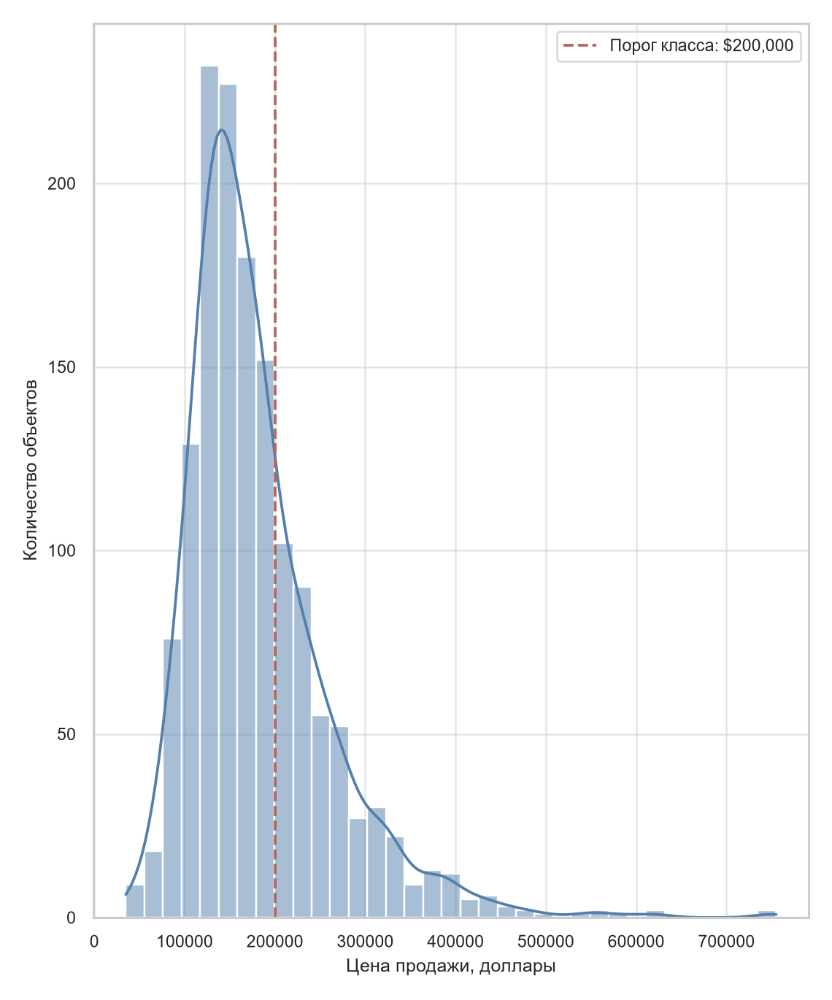

*Рисунок 1.11 - Распределение фактической стоимости продажи домов.*

Медианная цена ниже средней. Гистограмма `SalePrice` (цена продажи) имеет правостороннюю асимметрию, поскольку дорогих домов сравнительно немного. Вертикальная линия обозначает предварительный порог 200 000 USD, по которому мы делим дома на две ценовые категории для задачи классификации. Этот порог потребуется оценить с точки зрения баланса классов. Для регрессионных моделей важно проверить качество прогнозов на дорогих объектах, чтобы они не оставались без внимания за хорошими средними метриками.

### Корреляционный анализ и парные зависимости

Сопоставляем линейную связь числовых характеристик с ценой и ищем группы взаимосвязанных признаков. Корреляция не доказывает причинность.

<details>
<summary>Код ячейки 36</summary>

```python
print("Наиболее сильные корреляции с SalePrice:")
display(result.correlations.head(15).to_frame("r (Пирсон)"))
print("Пары с |r| ≥ 0.8 (потенциальная мультиколлинеарность):")
display(result.correlated_pairs)
display(Image(filename=str(result.plots["correlations"])))
```

</details>

```text
Наиболее сильные корреляции с SalePrice:
```

|  | r (Пирсон) |
| --- | --- |
| OverallQual | 0.790982 |
| GrLivArea | 0.708624 |
| GarageCars | 0.640409 |
| GarageArea | 0.623431 |
| TotalBsmtSF | 0.613581 |
| 1stFlrSF | 0.605852 |
| FullBath | 0.560664 |
| TotRmsAbvGrd | 0.533723 |
| YearBuilt | 0.522897 |
| YearRemodAdd | 0.507101 |
| GarageYrBlt | 0.486362 |
| MasVnrArea | 0.477493 |
| Fireplaces | 0.466929 |
| BsmtFinSF1 | 0.386420 |
| LotFrontage | 0.351799 |

```text
Пары с |r| ≥ 0.8 (потенциальная мультиколлинеарность):
```

|  | Признак A | Признак B | Корреляция r |
| --- | --- | --- | --- |
| 0 | GarageCars | GarageArea | 0.882475 |
| 1 | YearBuilt | GarageYrBlt | 0.825667 |
| 2 | GrLivArea | TotRmsAbvGrd | 0.825489 |
| 3 | TotalBsmtSF | 1stFlrSF | 0.819530 |

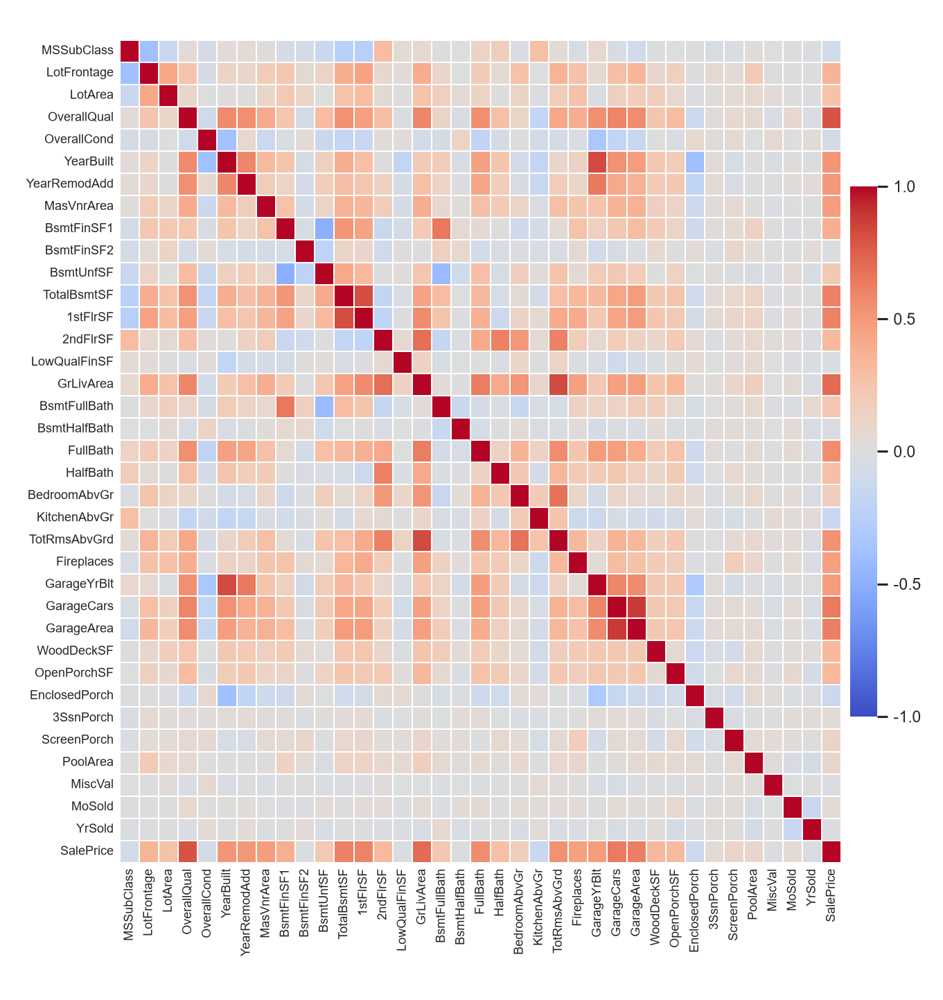

*Рисунок 1.12 - Корреляционная матрица числовых признаков и цены продажи.*

Красные оттенки на матрице показывают положительную линейную связь, синие - отрицательную, а светлые соответствуют значениям, близким к нулю. Наиболее заметная связь с `SalePrice` (ценой продажи) наблюдается у `OverallQual` (общего качества дома), `GrLivArea` (жилой площади), `GarageCars` (вместимости гаража в автомобилях), `GarageArea` (площади гаража) и `TotalBsmtSF` (общей площади подвала). Между некоторыми характеристиками также есть сильные связи, например между площадью гаража и его вместимостью. Это может означать, что несколько признаков частично повторяют одну и ту же информацию. При предобработке данных необходимо проверить такую взаимосвязь (мультиколлинеарность) и её влияние на качество моделей. Точные коэффициенты приведены в таблице выше.

Таблицы 1.6 и 1.7 - коэффициенты корреляции с ценой и пары взаимосвязанных признаков. Их следует интерпретировать вместе с корреляционной матрицей.

#### Парные зависимости ключевых характеристик

<details>
<summary>Код ячейки 39</summary>

```python
if "pairplot_01" in result.plots:
    display(Image(filename=str(result.plots["pairplot_01"])))
```

</details>

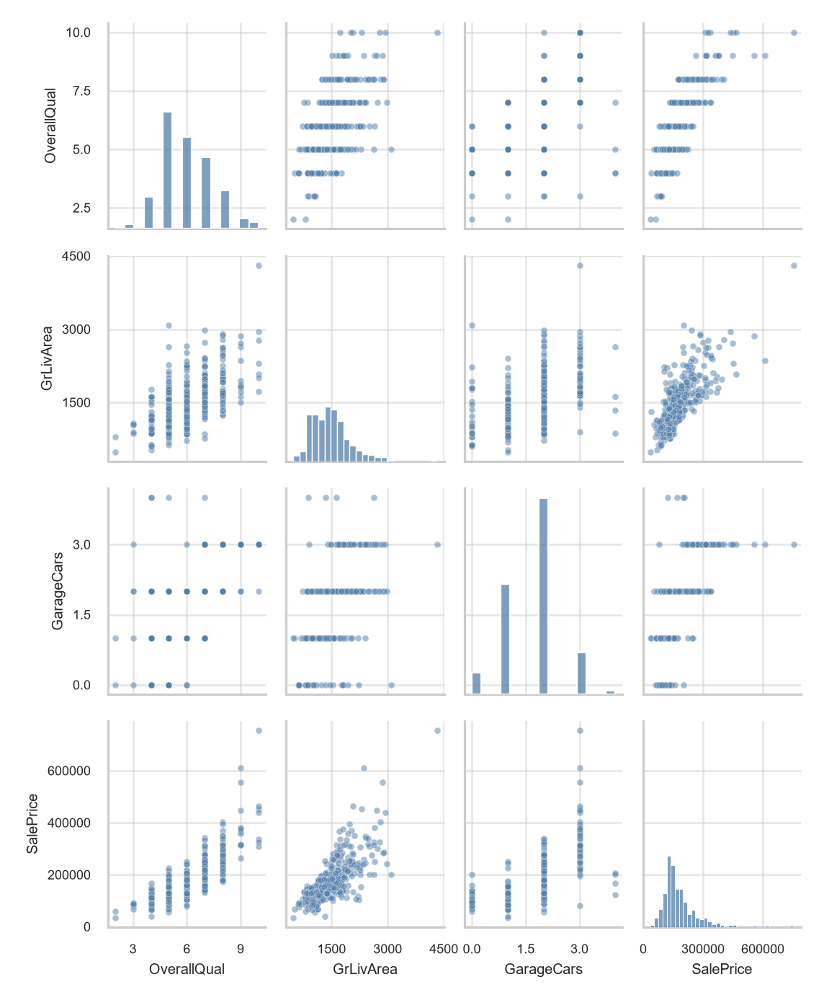

*Рисунок 1.13 - Парные зависимости наиболее связанных с ценой признаков (часть 1).*

На диагонали показаны распределения отдельных признаков, а в остальных ячейках - взаимосвязи между ними. С ростом `OverallQual` (общего качества дома) и `GrLivArea` (жилой площади) стоимость продажи, как правило, увеличивается, хотя встречаются дома со схожими характеристиками и разными ценами. `GarageCars` (вместимость гаража в автомобилях) принимает только целые значения, поэтому точки на диаграммах образуют полосы. Для удобства чтения графики построены на одной и той же воспроизводимой случайной выборке до 400 объектов. Коэффициенты корреляции в таблице выше рассчитаны по полным доступным данным.

<details>
<summary>Код ячейки 41</summary>

```python
if "pairplot_02" in result.plots:
    display(Image(filename=str(result.plots["pairplot_02"])))
```

</details>

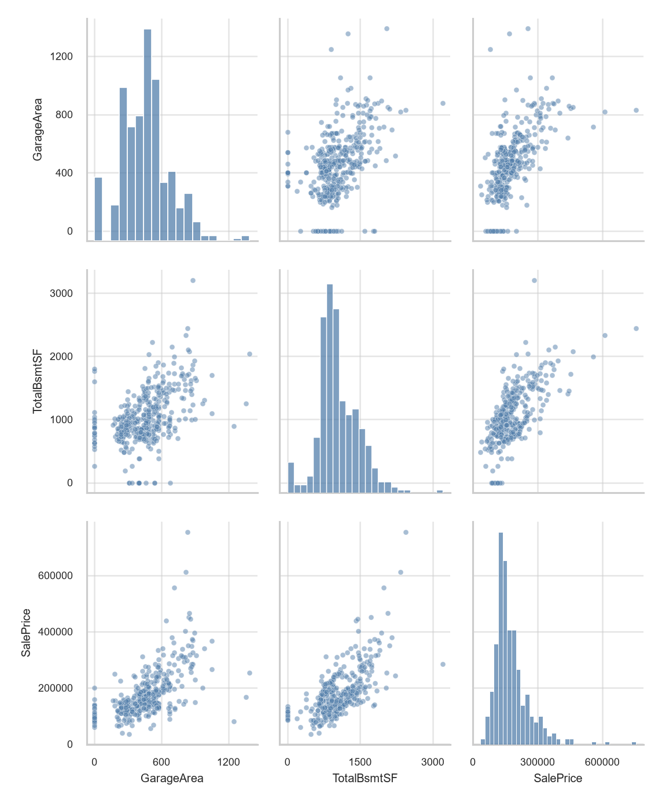

*Рисунок 1.14 - Парные зависимости связанных с ценой характеристик (часть 2).*

`GarageArea` (площадь гаража) и `TotalBsmtSF` (общая площадь подвала) обычно положительно связаны с `SalePrice` (ценой продажи). Однако у домов с одинаковой площадью гаража или подвала стоимость может существенно различаться. Одной характеристики недостаточно для точного прогноза. В дальнейшем сравним модели на отдельной тестовой выборке, не участвовавшей в обучении моделей. Ранее изученные тестовые объекты при этом не дают оснований считать такую оценку полностью независимой.

### Метод главных компонент (PCA)

Ниже - двумерная проекция **числовых характеристик без `Id` и `SalePrice`**. Только для иллюстрации выполняются заполнение пропусков медианой и стандартизация. Это **не обучающий pipeline**, для моделей трансформации будут подбираться только на тренировочных данных.

<details>
<summary>Код ячейки 44</summary>

```python
if "pca" in result.plots:
    display(Image(filename=str(result.plots["pca"])))
```

</details>

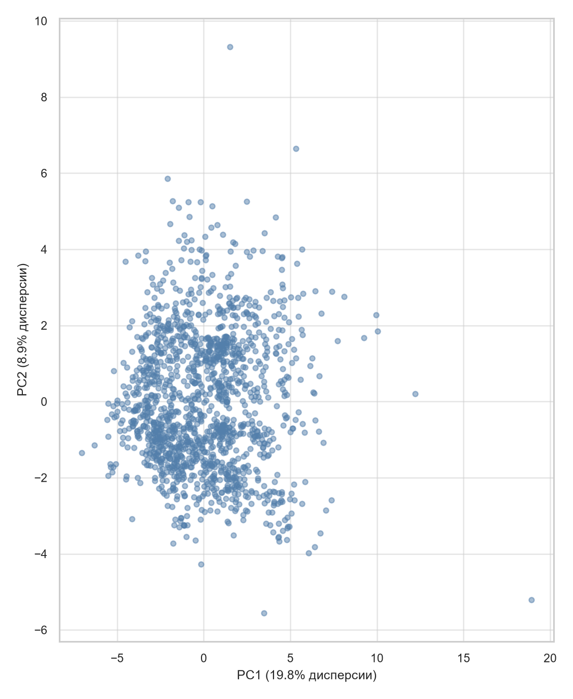

*Рисунок 1.15 - Двумерная проекция числовых характеристик методом главных компонент (PCA).*

В двумерной проекции PCA (метода главных компонент) большинство домов образуют общее облако, а отдельные точки находятся в стороне. Доли информации о разбросе объектов, сохранённые двумя первыми компонентами, указаны на осях. По этой проекции нельзя уверенно утверждать ни наличие, ни отсутствие групп похожих домов. Дальнейшая кластеризация будет учитывать больше характеристик.

### Постановка задач машинного обучения

**Регрессия** - предсказать реальную цену продажи `SalePrice` (USD). Для оценки используются MAE, RMSE и R².

**Классификация** - определить, дорогой ли дом относительно предварительного фиксированного порога **200 000 USD**. Метрики - Precision, Recall, F1, ROC-AUC. Сам `SalePrice` и любые признаки, выведенные из него, исключаются из входов модели. Окончательный порог обоснуем по балансу классов.

**Кластеризация** - выделить группы похожих домов без использования `SalePrice`, категории цены и `Id`, метод K-means, визуализация PCA/t-SNE.

<details>
<summary>Код ячейки 47</summary>

```python
print(f"Предварительная граница категории: ${HIGH_PRICE_THRESHOLD:,}")
display(result.class_balance)
```

</details>

```text
Предварительная граница категории: $200,000
```

|  | Класс | Количество | Доля, % |
| --- | --- | --- | --- |
| 0 | 0 — менее $200,000 | 1025 | 70.2 |
| 1 | 1 — от $200,000 | 435 | 29.8 |

Таблица 1.8 - численность и доли предварительных ценовых классов. Баланс классов учитывается при последующей стратификации.

### Итоговые выводы по EDA

Исследование показало, что данные о недвижимости неоднородны. Часть характеристик записана категориальными кодами, часть представляет площади и количества, а некоторые признаки часто равны нулю. Пропуски тоже имеют разный смысл, иногда информации не хватает, а иногда соответствующий объект просто отсутствует. При подготовке данных необходимо учитывать эти различия, а при сравнении моделей проверять влияние дорогих и нетипичных домов, а также сильно взаимосвязанных признаков. `SalePrice` (цена продажи) не должна попадать во входные данные классификации и кластеризации, а `Id` (идентификатор записи) не является характеристикой дома.

Следующим этапом подготовим воспроизводимую последовательность преобразований, применяемую без утечки информации из тестовой выборки. Сводный отчёт сохраняется в `outputs/eda/lr01_eda_summary.md`, исходный файл Kaggle остаётся без изменений.

<details>
<summary>Код ячейки 49</summary>

```python
print("Разведочный анализ данных завершён.")
print(f"Сводный отчёт: {result.report_path}")
print(f"Количество подготовленных рисунков: {len(result.plots)}")
```

</details>

## 2. Предобработка данных и инженерия признаков

В этом исследовании подготовим исходные характеристики недвижимости к построению моделей. Сохраним связь между регрессией и классификацией, рассмотрим способы заполнения пропусков, обработки выбросов и создания новых признаков. Обучаемые преобразования будут подбираться только на тренировочной выборке.

### Подготовка окружения и загрузка данных

При выполнении Notebook используется тот же модуль `house_prices_ai`, что и при запуске через командную строку. Исходный `train.csv` не изменяется.

<details>
<summary>Код ячейки 3</summary>

```python
from pathlib import Path
import sys
import pandas as pd
from IPython.display import Image, display

# Определяем корень проекта независимо от каталога запуска.
ROOT = next(
    (
        path for path in (Path.cwd(), Path.cwd().parent)
        if (path / "house_prices_ai").is_dir()
    ),
    None
)

if ROOT is None:
    raise RuntimeError(
        "Не найден корень проекта House Prices AI"
    )

if str(ROOT) not in sys.path:
    sys.path.insert(0, str(ROOT))

from house_prices_ai.config import (
    RAW_TRAIN_FILE,
    OUTPUT_DIR,
    PROCESSED_DATA_DIR,
)
from house_prices_ai.data_loader import load_training_data
from house_prices_ai.preprocessing import (
    run_preprocessing,
    CLASS_THRESHOLD,
)

df = load_training_data(RAW_TRAIN_FILE)

print(f"Объектов: {len(df)}. Столбцов: {df.shape[1]}")
print(f"Пропущенных ячеек: {int(df.isna().sum().sum())}")
```

</details>

```text
Объектов: 1460. Столбцов: 81
Пропущенных ячеек: 6965
```

### Цели регрессии и классификации

Для регрессии целевой переменной остаётся `SalePrice` (цена продажи в долларах). Для классификации используем порог 200 000 USD.
Класс `0` обозначает объекты дешевле этого порога, а класс `1` включает объекты стоимостью от 200 000 USD.

В матрицу входных признаков не включаем цену продажи и `Id` (идентификатор записи). Разделение обучающей и тестовой частей проводится один раз, одинаково для обеих задач.

<details>
<summary>Код ячейки 5</summary>

```python
balance = (
    (df["SalePrice"] >= CLASS_THRESHOLD)
    .astype(int)
    .value_counts()
    .sort_index()
)

balance.index.name = "Ценовой класс"

display(pd.DataFrame({
    "Число объектов": balance,
    "Доля, %": (balance / len(df) * 100).round(1)
}))
```

</details>

| Ценовой класс | Число объектов | Доля, % |
|---|---:|---:|
| 0 | 1 025 | 70,2 |
| 1 | 435 | 29,8 |

### Выполнение предобработки

Обработка пропусков учитывает смысл признаков. Например, пустое значение `GarageType` (тип гаража) описывает отсутствие гаража, а неизвестная ширина участка `LotFrontage` заполняется медианой, вычисленной по обучающей выборке.

Для шести непрерывных характеристик применяется ограничение крайних значений по правилу 1,5 IQR. Границы рассчитываются только на обучающей выборке и затем без изменений применяются к тестовой. Это осознанное допущение, а не доказательство ошибочности дорогих или больших домов. При сравнении моделей потребуется проверить, как ограничение влияет на точность прогнозов.

<details>
<summary>Код ячейки 7</summary>

```python
result = run_preprocessing(RAW_TRAIN_FILE, OUTPUT_DIR / "preprocessing", PROCESSED_DATA_DIR)
print("Подготовка завершена")
print(f"Обучающая выборка: {result.train_rows} строк")
print(f"Тестовая выборка: {result.test_rows} строк")
print(f"Признаков после кодирования: {result.features_count}")
print(f"Отчёт: {result.report_path}")
```

</details>

```text
Подготовка завершена
Обучающая выборка: 1168 строк
Тестовая выборка: 292 строк
Признаков после кодирования: 316
Отчёт: outputs/preprocessing/preprocessing_summary.md
```

#### Пропуски в обучающей выборке

<details>
<summary>Код ячейки 9</summary>

```python
display(Image(filename=str(result.generated_plots["missing"])))
```

</details>

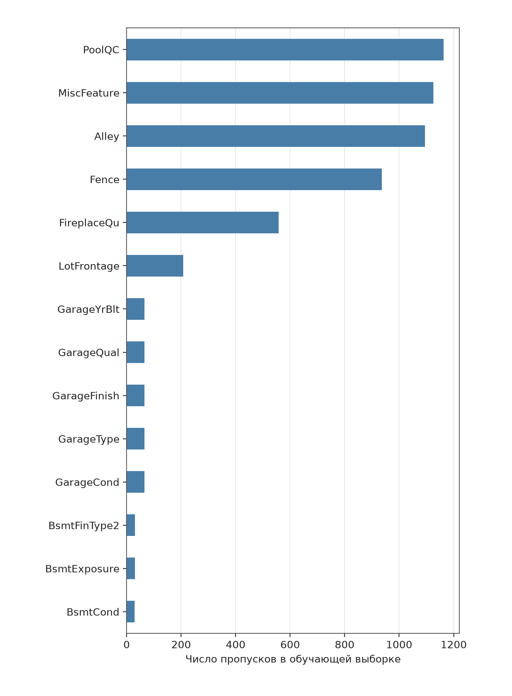

*Рисунок 2.1 - Распределение пропущенных значений по характеристикам недвижимости.*

Пропуски наиболее характерны для признаков, описывающих дополнительные элементы дома и участка. При подготовке данных важно не смешивать отсутствие объекта с неизвестным значением. Медиана и константы определяются на тренировочных строках, поэтому тестовая выборка не влияет на выбор способа заполнения.

#### Сколько значений изменено при обработке выбросов

Количество потенциальных выбросов, найденных по правилу IQR, не равно числу удалённых домов. Мы не удаляем наблюдения, а ограничиваем только шесть непрерывных характеристик. В следующей таблице показаны нижняя и верхняя границы, количество значений, попавших за эти границы, и доля фактически изменённых ячеек. Результаты рассчитаны отдельно для обучающей и тестовой выборок.

<details>
<summary>Код ячейки 12</summary>

```python
outlier_changes = pd.read_csv(OUTPUT_DIR / "preprocessing" / "outlier_changes.csv")
display(outlier_changes[["Выборка", "Признак", "Ниже границы", "Выше границы",
                         "Всего изменено", "Доля изменённых, %"]])
for split in ("train", "test"):
    changed = int(outlier_changes.loc[outlier_changes["Выборка"] == split, "Всего изменено"].sum())
    print(f"{split}: скорректировано {changed} значений в выбранных признаках")
```

</details>

|  | Выборка | Признак | Ниже границы | Выше границы | Всего изменено | Доля изменённых, % |
| --- | --- | --- | --- | --- | --- | --- |
| 0 | train | LotArea | 1 | 51 | 52 | 4.45 |
| 1 | train | GrLivArea | 0 | 27 | 27 | 2.31 |
| 2 | train | TotalBsmtSF | 0 | 21 | 21 | 1.80 |
| 3 | train | GarageArea | 0 | 20 | 20 | 1.71 |
| 4 | train | 1stFlrSF | 0 | 19 | 19 | 1.63 |
| 5 | train | 2ndFlrSF | 0 | 2 | 2 | 0.17 |
| 6 | test | LotArea | 0 | 15 | 15 | 5.14 |
| 7 | test | GrLivArea | 0 | 4 | 4 | 1.37 |
| 8 | test | TotalBsmtSF | 0 | 3 | 3 | 1.03 |
| 9 | test | GarageArea | 0 | 1 | 1 | 0.34 |
| 10 | test | 1stFlrSF | 0 | 2 | 2 | 0.68 |
| 11 | test | 2ndFlrSF | 0 | 0 | 0 | 0.00 |

```text
train: скорректировано 141 значений в выбранных признаках
test: скорректировано 25 значений в выбранных признаках
```

Таблица 2.1 - изменение значений непрерывных признаков после IQR-обработки.

Значения ограничивались границами, определёнными только на обучающих объектах. Таким образом, тестовые наблюдения не участвуют в определении границ обработки выбросов. При этом большие площади могут быть реальными особенностями недвижимости, поэтому влияние такого ограничения на качество моделей требует отдельного сравнительного эксперимента.

### Кодирование и масштабирование

Номинальные категории, например `Neighborhood` (район), преобразуются методом One-Hot Encoding. Числовые характеристики стандартизируются. В результате их значения выражаются в сопоставимом масштабе. Колонки `MSSubClass` (тип здания) обрабатываются как категории, несмотря на числовые коды.

Это особенно важно для моделей, чувствительных к разным масштабам, в том числе линейной регрессии и нейросетей.

<details>
<summary>Код ячейки 15</summary>

```python
x_train = pd.read_csv(PROCESSED_DATA_DIR / "X_train_reg.csv")
x_test = pd.read_csv(PROCESSED_DATA_DIR / "X_test_reg.csv")
print(f"Размерность: train {x_train.shape}, test {x_test.shape}")
print(f"Пропусков после обработки: {int(x_train.isna().sum().sum()) + int(x_test.isna().sum().sum())}")
print(f"Колонки совпадают: {x_train.columns.equals(x_test.columns)}")
display(x_train.iloc[:5, :8])
```

</details>

```text
Размерность: train (1168, 316), test (292, 316)
Пропусков после обработки: 0
Колонки совпадают: True
```

|  | num__LotFrontage | num__LotArea | num__OverallQual | num__OverallCond | num__YearBuilt | num__YearRemodAdd | num__MasVnrArea | num__BsmtFinSF1 |
| --- | --- | --- | --- | --- | --- | --- | --- | --- |
| 0 | 1.650612 | 1.635021 | -0.074699 | -0.533044 | 1.151933 | 1.018960 | -0.569186 | -0.963901 |
| 1 | -0.029651 | 0.153706 | -0.795759 | -0.533044 | -0.301366 | -1.119665 | -0.569186 | 0.718887 |
| 2 | 0.110371 | -0.277759 | 0.646361 | -0.533044 | 1.251022 | 1.164775 | -0.569186 | -0.912387 |
| 3 | 1.043851 | 0.649407 | 1.367422 | -0.533044 | 1.251022 | 1.213380 | -0.116396 | -0.963901 |
| 4 | 0.950503 | 0.308923 | -0.795759 | 2.135221 | 0.161047 | 0.921749 | -0.569186 | 1.519499 |

### Новые характеристики недвижимости

Из исходных данных рассчитываются суммарная площадь, возраст дома на момент продажи, время после реконструкции, число санузлов с учётом половинных, а также наличие гаража и подвала.

`TotalUsefulSF` (суммарная площадь) составляется из `TotalBsmtSF` (общая площадь подвала), `1stFlrSF` (площадь первого этажа) и `2ndFlrSF` (площадь второго этажа). После заполнения пропусков и ограничения крайних значений компонентов эта сумма пересчитывается до стандартизации, чтобы характеристики объекта оставались согласованными в исходных единицах измерения.

Наличие новых характеристик само по себе не подтверждает улучшение прогноза. Их полезность необходимо оценивать при отдельном сравнении с исходным набором признаков.

<details>
<summary>Код ячейки 17</summary>

```python
names = pd.read_csv(OUTPUT_DIR / "preprocessing" / "feature_names.csv")
for term in ("TotalUsefulSF", "PropertyAgeAtSale", "YearsSinceRemodel", "TotalBathrooms", "HasGarage", "HasBasement"):
    print(f"{term}: {'создан' if names['Признак'].str.contains(term, regex=False).any() else 'отсутствует'}")
```

</details>

```text
TotalUsefulSF: создан
PropertyAgeAtSale: создан
YearsSinceRemodel: создан
TotalBathrooms: создан
HasGarage: создан
HasBasement: создан
```

### Отбор информативных признаков

Метод SelectKBest оценивает статистическую связь каждого признака с ценой продажи. RFE последовательно исключает признаки по результатам линейной модели. Полученные списки нужны для сравнения альтернативных наборов признаков, но на данном этапе мы не удаляем их автоматически из итоговой матрицы.

<details>
<summary>Код ячейки 19</summary>

```python
display(Image(filename=str(result.generated_plots["scores"])))
```

</details>

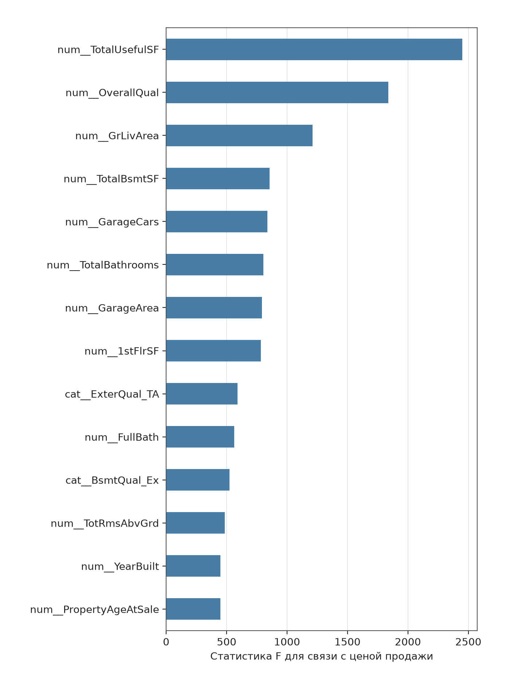

*Рисунок 2.2 - Наиболее информативные признаки недвижимости по статистике F.*

Высокая F-статистика сама по себе не гарантирует повышения качества прогноза. Некоторые характеристики сильно связаны друг с другом, например `GarageArea` (площадь гаража) и `GarageCars` (вместимость гаража в автомобилях). Проверка пользы отбора потребует сравнения моделей с полным и сокращённым наборами признаков.

<details>
<summary>Код ячейки 21</summary>

```python
print("SelectKBest — первые 10 признаков:")
for name in result.selected_kbest[:10]:
    print(" ", name)
print("\nRFE — первые 10 признаков:")
for name in result.selected_rfe[:10]:
    print(" ", name)
```

</details>

```text
SelectKBest — первые 10 признаков:
  num__OverallQual
  num__YearBuilt
  num__YearRemodAdd
  num__MasVnrArea
  num__TotalBsmtSF
  num__1stFlrSF
  num__GrLivArea
  num__FullBath
  num__TotRmsAbvGrd
  num__GarageCars

RFE — первые 10 признаков:
  num__TotalUsefulSF
  num__GrLivArea
  num__1stFlrSF
  cat__BsmtQual_Ex
  num__YearBuilt
  num__PropertyAgeAtSale
  num__YearsSinceRemodel
  num__YearRemodAdd
  cat__KitchenQual_Ex
  cat__ExterQual_Ex
```

### Мультиколлинеарность (VIF)

VIF показывает, насколько сильно один признак линейно связан с остальными. Высокие значения особенно важны при интерпретации коэффициентов линейной регрессии.

Сначала рассмотрим **полный набор из 14 числовых характеристик**, где сохраняются производные признаки. Затем повторим расчёт без `TotalUsefulSF` (суммарная площадь), `PropertyAgeAtSale` (возраст при продаже) и `YearsSinceRemodel` (лет после реконструкции). Эти три признака исключаются только из второго расчёта VIF. Из подготовленных данных для моделей ничего не удаляем.

<details>
<summary>Код ячейки 23</summary>

```python
import numpy as np
vif_full = pd.read_csv(OUTPUT_DIR / "preprocessing" / "vif.csv")
vif_reduced = pd.read_csv(OUTPUT_DIR / "preprocessing" / "vif_reduced.csv")
vif_diagnostics = pd.read_csv(OUTPUT_DIR / "preprocessing" / "vif_diagnostics.csv")
print("Проверка ранга и обусловленности:")
display(vif_diagnostics)
print("Полный набор признаков:")
display(vif_full)
print("Сокращённый набор — только для оценки VIF:")
display(vif_reduced)
for name, table in (("Полный", vif_full), ("Сокращённый", vif_reduced)):
    print(f"{name}: VIF > 10 у {(table['VIF'] > 10).sum()} признаков; "
          f"бесконечный VIF у {np.isinf(table['VIF']).sum()}")
```

</details>

```text
Проверка ранга и обусловленности:
```

|  | Набор | Признаков | Ранг | Число обусловленности | Линейная зависимость |
| --- | --- | --- | --- | --- | --- |
| 0 | Полный | 14 | 13 | 1.136269e+16 | True |
| 1 | Сокращённый | 11 | 11 | 1.916828e+01 | False |

```text
Полный набор признаков:
```

|  | Признак | VIF | Интерпретация |
| --- | --- | --- | --- |
| 0 | TotalBsmtSF | inf | Точная линейная зависимость |
| 1 | 1stFlrSF | inf | Точная линейная зависимость |
| 2 | 2ndFlrSF | inf | Точная линейная зависимость |
| 3 | TotalUsefulSF | inf | Точная линейная зависимость |
| 4 | PropertyAgeAtSale | 1.181539e+06 | Сильная мультиколлинеарность |
| 5 | YearBuilt | 1.177809e+06 | Сильная мультиколлинеарность |
| 6 | YearRemodAdd | 5.439785e+05 | Сильная мультиколлинеарность |
| 7 | YearsSinceRemodel | 5.438448e+05 | Сильная мультиколлинеарность |
| 8 | GrLivArea | 3.352969e+01 | Сильная мультиколлинеарность |
| 9 | GarageCars | 5.771531e+00 | Требует внимания |
| 10 | GarageArea | 5.386448e+00 | Требует внимания |
| 11 | OverallQual | 2.852415e+00 | Умеренная или низкая |
| 12 | TotalBathrooms | 2.191195e+00 | Умеренная или низкая |
| 13 | LotArea | 1.470184e+00 | Умеренная или низкая |

```text
Сокращённый набор — только для оценки VIF:
```

|  | Признак | VIF | Интерпретация |
| --- | --- | --- | --- |
| 0 | GrLivArea | 31.050103 | Сильная мультиколлинеарность |
| 1 | 2ndFlrSF | 23.802989 | Сильная мультиколлинеарность |
| 2 | 1stFlrSF | 19.243945 | Сильная мультиколлинеарность |
| 3 | GarageCars | 5.767159 | Требует внимания |
| 4 | GarageArea | 5.385341 | Требует внимания |
| 5 | TotalBsmtSF | 3.683666 | Умеренная или низкая |
| 6 | OverallQual | 2.851307 | Умеренная или низкая |
| 7 | YearBuilt | 2.339274 | Умеренная или низкая |
| 8 | TotalBathrooms | 2.185869 | Умеренная или низкая |
| 9 | YearRemodAdd | 1.734437 | Умеренная или низкая |
| 10 | LotArea | 1.469876 | Умеренная или низкая |

```text
Полный: VIF > 10 у 9 признаков; бесконечный VIF у 4
Сокращённый: VIF > 10 у 3 признаков; бесконечный VIF у 0
```

Таблицы 2.2-2.4 - диагностика ранга матрицы и оценка VIF до и после исключения взаимозависимых признаков.

В полном наборе `TotalUsefulSF` (суммарная площадь) точно равна сумме `TotalBsmtSF` (площадь подвала), `1stFlrSF` (площадь первого этажа) и `2ndFlrSF` (площадь второго этажа). Поэтому матрица может иметь неполный ранг, а VIF для взаимозависимых характеристик становится бесконечным. Это свойство самих данных, а не ошибка библиотеки.

Сокращённый расчёт помогает увидеть остальные связи, например между `GrLivArea` (жилая площадь) и площадями этажей, либо между `GarageCars` (вместимость гаража) и `GarageArea` (площадь гаража). Даже после исключения трёх производных характеристик VIF отдельных признаков может оставаться высоким.

Влияние исключения взаимозависимых признаков следует оценивать при сравнении линейных моделей. Удалять все признаки с высоким VIF автоматически не нужно. Это может ухудшить качество прогнозирования.

### PCA и структура подготовленных данных

Метод главных компонент показывает, как объекты располагаются в пространстве двух новых координат. PCA подбирается на тренировочной выборке, а тестовые наблюдения только преобразуются с уже найденными коэффициентами. Для визуализации можно выделить ценовые классы цветом, но они не используются при вычислении компонент.

<details>
<summary>Код ячейки 26</summary>

```python
display(Image(filename=str(result.generated_plots["pca"])))
print(f"Две компоненты объясняют {sum(result.pca_explained_variance):.1%} дисперсии")
```

</details>

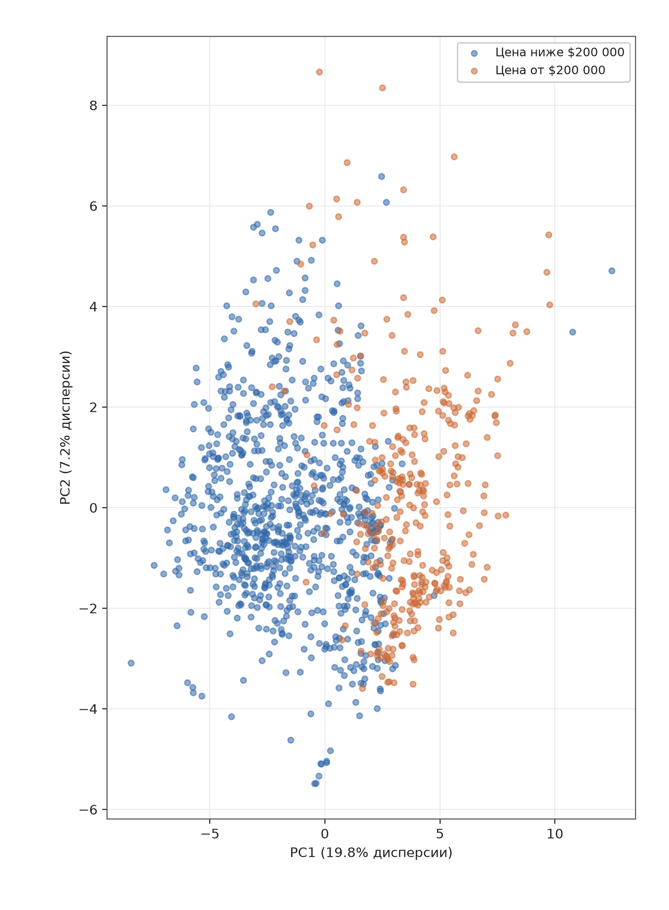

```text
Две компоненты объясняют 27.0% дисперсии
```

*Рисунок 2.3 - Проекция подготовленных данных на первые две главные компоненты (PCA).*

Две компоненты отражают лишь часть разнообразия характеристик. Цвет точек обозначает ценовую категорию, однако при настройке PCA она не используется. По двумерному графику нельзя уверенно заключить, что существуют обособленные группы недвижимости. Отдельный анализ кластеров проведём позднее.

### Выводы

Для регрессии и классификации получены согласованные обучающие и тестовые выборки, а также целевые переменные. Исходный набор данных остался без изменений. Таблица `outlier_changes.csv` показывает фактическое количество ограниченных значений отдельно для каждой выборки.

Влияние обработки выбросов и новых признаков на качество моделей требует самостоятельной оценки. Для линейных моделей отдельно рассмотрим влияние признаков с высокими VIF. Все операции, которым требуется обучение на данных, настроены только на тренировочной части.

<details>
<summary>Код ячейки 29</summary>

```python
expected = ["X_train_reg.csv", "X_test_reg.csv", "y_train_reg.csv", "y_test_reg.csv",
            "X_train_clf.csv", "X_test_clf.csv", "y_train_clf.csv", "y_test_clf.csv"]
display(pd.DataFrame({"Файл": expected,
                      "Сохранён": [(PROCESSED_DATA_DIR / name).is_file() for name in expected]}))
print("Обученный pipeline:", OUTPUT_DIR / "preprocessing" / "preprocessing_pipeline.joblib")
```

</details>

|  | Файл | Сохранён |
| --- | --- | --- |
| 0 | X_train_reg.csv | True |
| 1 | X_test_reg.csv | True |
| 2 | y_train_reg.csv | True |
| 3 | y_test_reg.csv | True |
| 4 | X_train_clf.csv | True |
| 5 | X_test_clf.csv | True |
| 6 | y_train_clf.csv | True |
| 7 | y_test_clf.csv | True |

```text
Обученный pipeline: outputs/preprocessing/preprocessing_pipeline.joblib
```

## 3. Регрессия и сравнение моделей

**Исследуемые алгоритмы** - DummyRegressor (базовый ориентир), LinearRegression, Ridge, Lasso, RandomForestRegressor, XGBRegressor, MLPRegressor.

### Методика и организация данных

В предобработке данных из 1 460 домов выделены 1 168 объектов для обучения и 292 объекта для внешнего тестирования. Сохраняем то же исходное разбиение по `Id`. Для кросс-валидации используются исходные характеристики обучающей выборки, а не заранее преобразованная матрица `X_train_reg.csv`.

**Фолд (fold)** - один из пяти непересекающихся блоков обучающих объектов. При 5-Fold CV модель обучается пять раз, каждый раз на четырёх блоках (около 934–935 домов), а оставшийся блок (233–234 дома) служит для проверки. Каждый дом участвует в проверке ровно один раз. Разбиения перемешиваются и воспроизводятся с `random_state=42`.

В каждом повторении создаётся новая копия Pipeline. Инженерия признаков, заполнение пропусков, IQR-ограничения, One-Hot Encoding и StandardScaler настраиваются исключительно по четырём обучающим блокам. К проверочному блоку применяется только `transform()`. Таким образом, статистики предобработки не попадают из валидации в обучение.

Качество оценивается по MAE (средней абсолютной ошибке в USD), RMSE (корню из средней квадратичной ошибки в USD) и **R² (коэффициенту детерминации)**. В отличие от MAE и RMSE, R² безразмерен и сопоставляет сумму квадратов ошибок модели с ошибкой простого прогноза среднего значения проверочной выборки.

$$
R^2=1-\frac{\sum_i(y_i-\hat y_i)^2}{\sum_i(y_i-\bar y)^2}.
$$

Значение R² = 1 соответствует точным предсказаниям, R² = 0 соответствует по сумме квадратов ошибок прогнозу среднего значения, отрицательный R² означает результат хуже такого ориентира. **R² = 0,89 не означает, что цена угадана с точностью 89%**. В таблице CV показано среднее пяти отдельных R², поэтому оно не тождественно R², рассчитанному на всех объединённых прогнозах.

Внешние 292 объекта не используются при выборе гиперпараметров. Поскольку в предыдущих экспериментах мы уже изучали отдельные тестовые дома, результаты внешнего теста рассматриваются как дополнительные описательные оценки, а не как полностью нетронутая независимая проверка.

<details>
<summary>Код ячейки 3</summary>

```python
from pathlib import Path
import sys
import pandas as pd
from IPython.display import display, Image, Markdown

# Открывается и из корня репозитория, и из каталога notebooks/.
ROOT = next((p for p in (Path.cwd(), Path.cwd().parent) if (p / "house_prices_ai").is_dir()), None)
if ROOT is None:
    raise RuntimeError("Откройте JupyterLab в каталоге репозитория House Prices AI")
if str(ROOT) not in sys.path:
    sys.path.insert(0, str(ROOT))

from house_prices_ai.config import PROJECT_ROOT, OUTPUT_DIR
from house_prices_ai.regression import load_lr02_split, run_regression

RESULTS = OUTPUT_DIR / "regression"
FIGURES = RESULTS / "figures"

X_train, X_test, y_train, y_test = load_lr02_split()
print(f"Train: {X_train.shape}, Test: {X_test.shape}")
print(f"Цель: {y_train.name}, диапазон SalePrice: {y_train.min():,.0f}–{y_train.max():,.0f} USD")
```

</details>

```text
Train: (1168, 79), Test: (292, 79)
Цель: SalePrice, диапазон SalePrice: 34,900–755,000 USD
```

### Выполнение сравнительного эксперимента

Если результаты ещё не созданы, первая команда автоматически запускает обучение и 5-Fold CV. Если файлы уже присутствуют после `python main.py regression`, они используются повторно. Для полного подбора параметров XGBoost отдельно выполнить `python main.py regression --tune-xgb`.

Параметры базовых моделей не выбираются по тесту. Для MLP масштабируется также `SalePrice`, внутренний механизм Early Stopping использует дополнительную валидацию из обучающего фолда.

<details>
<summary>Код ячейки 5</summary>

```python
if not (RESULTS / "cv_clean_summary.csv").exists():
    run_regression(folds=5, tune=False, make_plots=True)

cv_summary = pd.read_csv(RESULTS / "cv_clean_summary.csv")
cv_folds = pd.read_csv(RESULTS / "cv_clean_folds.csv")
test_summary = pd.read_csv(RESULTS / "test_descriptive.csv")

display(cv_summary.round(4))
```

</details>

|  | Model | R2_mean | R2_std | Train_R2_mean | MAE_mean | MAE_std | RMSE_mean | RMSE_std |
| --- | --- | --- | --- | --- | --- | --- | --- | --- |
| 0 | XGBoost | 0.8903 | 0.0488 | 0.9822 | 14959.3280 | 1600.4618 | 25785.5023 | 6387.7708 |
| 1 | Random Forest | 0.8664 | 0.0481 | 0.9790 | 16937.0983 | 1643.4805 | 28691.9553 | 5011.7075 |
| 2 | Lasso | 0.8150 | 0.1040 | 0.9226 | 17681.3522 | 1807.6080 | 32830.4711 | 8117.2174 |
| 3 | Ridge | 0.8019 | 0.1090 | 0.9187 | 18357.0862 | 1682.4848 | 34107.6720 | 8517.4640 |
| 4 | LinearRegression | 0.5521 | 0.4874 | 0.9552 | 20240.3328 | 2851.4024 | 46382.3205 | 22284.8726 |
| 5 | MLP | 0.7385 | 0.1496 | 0.9119 | 21357.2538 | 3242.5034 | 39290.1109 | 10058.2001 |
| 6 | DummyRegressor | -0.0070 | 0.0093 | 0.0000 | 57501.5657 | 2524.5457 | 80255.0065 | 7051.9135 |

Таблица 3.1 - средние показатели качества базовых регрессионных моделей по пяти фолдам.

Сопоставим средние R², MAE и RMSE с их разбросом между фолдами. Большое стандартное отклонение `R2_std` указывает на зависимость качества от состава проверочного блока, а разница `Train_R2_mean − R2_mean` помогает выявить переобучение или нестабильность модели.

<details>
<summary>Код ячейки 7</summary>

```python
print("R² на пяти разбиениях:")
display(cv_folds.pivot(index="Fold", columns="Model", values="R2").round(4))

best_model_name = str(cv_summary.iloc[0]["Model"])
print(f"Лучший алгоритм по CV MAE: {best_model_name}")
```

</details>

```text
R² на пяти разбиениях:
```

| Model | DummyRegressor | Lasso | LinearRegression | MLP | Random Forest | Ridge | XGBoost |
| --- | --- | --- | --- | --- | --- | --- | --- |
| Fold |  |  |  |  |  |  |  |
| 1 | -0.0015 | 0.7759 | 0.5879 | 0.7284 | 0.8359 | 0.7482 | 0.8204 |
| 2 | -0.0058 | 0.9088 | 0.8158 | 0.8067 | 0.9103 | 0.8961 | 0.9427 |
| 3 | -0.0008 | 0.6295 | -0.3986 | 0.4584 | 0.7862 | 0.6116 | 0.8448 |
| 4 | -0.0016 | 0.8999 | 0.8982 | 0.8049 | 0.8969 | 0.8885 | 0.9326 |
| 5 | -0.0252 | 0.8609 | 0.8574 | 0.8942 | 0.9029 | 0.8649 | 0.9112 |

```text
Лучший алгоритм по CV MAE: XGBoost
```

Таблица 3.2 - коэффициенты R² по отдельным проверочным фолдам. Разброс значений показывает устойчивость моделей к изменению состава выборки.

### Сравнение метрик и устойчивости

Диаграммы сделаны на белом фоне для печати на книжном листе A4. Подписи вынесены **под** рисунки (сквозная нумерация главы 3).

<details>
<summary>Код ячейки 9</summary>

```python
def show_figure(name, caption):
    path = FIGURES / name
    if path.exists():
        display(Image(filename=str(path), width=520))
    else:
        print(f"Рисунок ещё не создан: {path}")
    display(Markdown(f"*{caption}*"))

show_figure("3_1_cv_mae.png", "Рисунок 3.1 — Средние значения R², MAE и RMSE по пяти фолдам.")
```

</details>

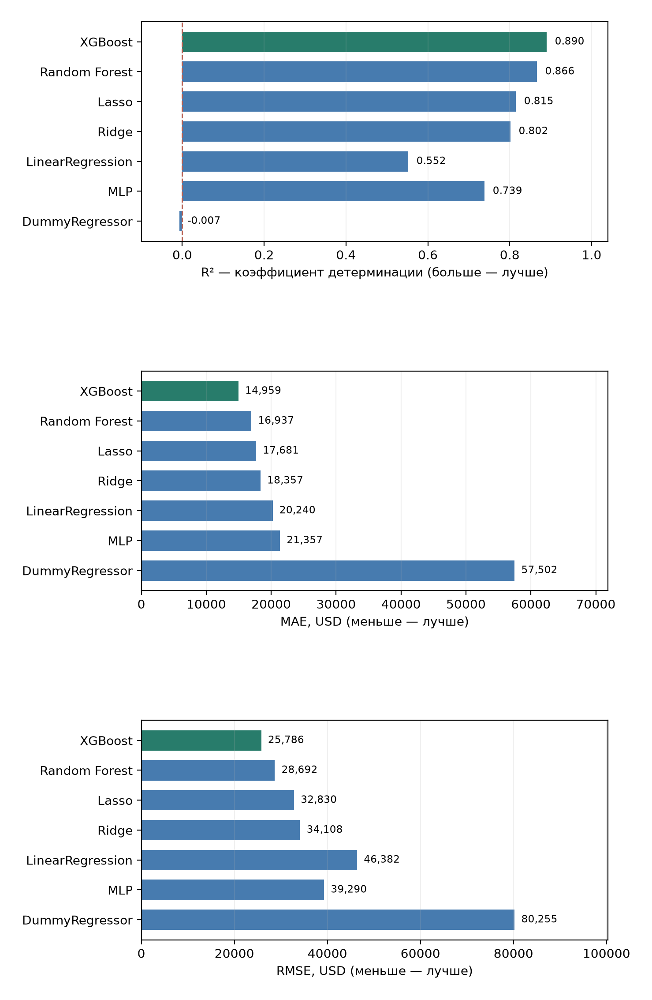

*Рисунок 3.1 - Средние значения R², MAE и RMSE по пяти фолдам.*

На рисунке 3.1 сравниваются три метрики, каждая на собственной шкале. **XGBoost** показывает наибольший средний R² (0,8903) и наименьшие ошибки MAE (14 959 USD) и RMSE (25 786 USD). Ближайший конкурент по средней абсолютной ошибке - Random Forest (16 937 USD). DummyRegressor заметно уступает обучаемым алгоритмам, поскольку ориентируется только на среднюю цену обучающих объектов. Значения MAE и RMSE выражены в долларах, а R² не имеет единиц измерения.

<details>
<summary>Код ячейки 11</summary>

```python
show_figure("3_2_cv_r2_folds.png", "Рисунок 3.2 — Распределение R² по пяти проверочным фолдам.")
```

</details>

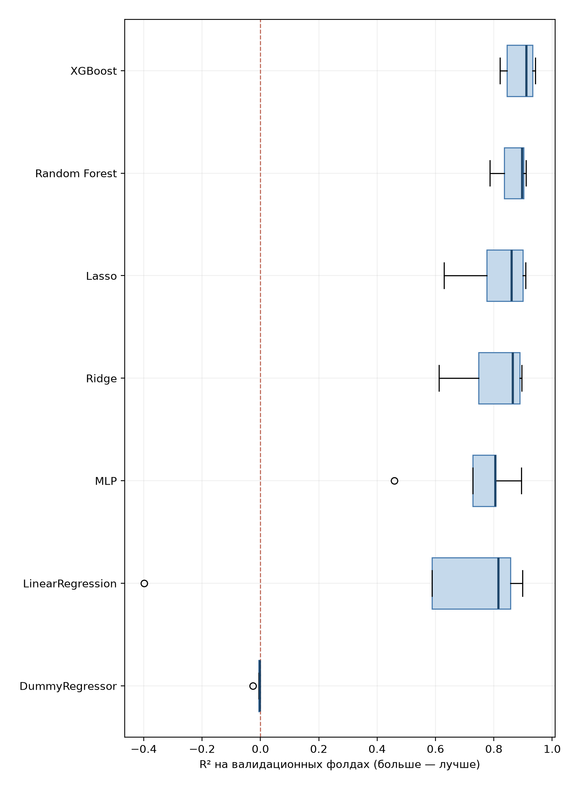

*Рисунок 3.2 - Распределение R² по пяти проверочным фолдам.*

На рисунке 3.2 виден разброс качества при изменении состава обучающих и проверочных данных. У XGBoost и Random Forest значения R² относительно стабильны, стандартные отклонения составляют 0,0488 и 0,0481 соответственно. У LinearRegression разброс значительно выше (0,4874), а на третьем фолде получено отрицательное значение R² = −0,3986. Это означает, что на данном блоке модель ошибалась сильнее, чем прогноз среднего значения цены. Регуляризованные Ridge и Lasso уменьшили нестабильность обычной линейной регрессии, но сохранили чувствительность к отдельным разбиениям.

#### Сопоставление качества и устойчивости

Рисунки 3.1 и 3.2 совместно показывают преимущество XGBoost в рассмотренном эксперименте. Модель достигает минимальных средних ошибок и сохраняет сравнительно стабильное качество на разных фолдах. Random Forest является ближайшим конкурентом. У LinearRegression высокий тренировочный R² не сопровождается сопоставимым результатом на проверочных данных, что согласуется с выявленной ранее нестабильностью коэффициентов при зависимых признаках. Выбор XGBoost на данном этапе основан на пятифолдовой CV базовых конфигураций, а не на внешнем тесте или результатах последующего подбора параметров.

<details>
<summary>Код ячейки 14</summary>

```python
best = cv_summary.iloc[0]
second = cv_summary.iloc[1]
linear = cv_summary.loc[cv_summary.Model == "LinearRegression"].iloc[0]
mlp_cv = cv_summary.loc[cv_summary.Model == "MLP"].iloc[0]
print(
    f"Лидер по средней MAE — {best.Model}: {best.MAE_mean:,.0f} USD, "
    f"RMSE = {best.RMSE_mean:,.0f} USD, R² = {best.R2_mean:.4f} "
    f"(std R² = {best.R2_std:.4f})."
)
print(
    f"Разница MAE относительно второй модели ({second.Model}): "
    f"{second.MAE_mean-best.MAE_mean:,.0f} USD "
    f"({(second.MAE_mean-best.MAE_mean)/second.MAE_mean*100:.1f}%)."
)
print(
    f"LinearRegression: средний R² train = {linear.Train_R2_mean:.4f}, "
    f"CV R² = {linear.R2_mean:.4f}, std = {linear.R2_std:.4f}."
)
print(
    f"MLP: средний R² train = {mlp_cv.Train_R2_mean:.4f}, "
    f"CV R² = {mlp_cv.R2_mean:.4f}, std = {mlp_cv.R2_std:.4f}."
)
```

</details>

```text
Лидер по средней MAE — XGBoost: 14,959 USD, RMSE = 25,786 USD, R² = 0.8903 (std R² = 0.0488).
Разница MAE относительно второй модели (Random Forest): 1,978 USD (11.7%).
LinearRegression: средний R² train = 0.9552, CV R² = 0.5521, std = 0.4874.
MLP: средний R² train = 0.9119, CV R² = 0.7385, std = 0.1496.
```

### Диагностика прогнозов и остатков лучшей по CV модели

Используем **out-of-fold (OOF)** прогнозы. Каждый обучающий объект предсказывается моделью, которая его не видела во время обучения соответствующего фолда. Это позволяет получить графики без привлечения внешнего теста.

<details>
<summary>Код ячейки 16</summary>

```python
oof = pd.read_csv(RESULTS / "oof_predictions.csv")
print("OOF-объектов:", len(oof))
display(oof.head())

show_figure("3_3_oof_actual_vs_pred.png", "Рисунок 3.3 — Фактические цены и OOF-прогнозы выбранной модели.")
```

</details>

```text
OOF-объектов: 1168
```

|  | Id | SalePrice | OOF_Pred | Residual |
| --- | --- | --- | --- | --- |
| 0 | 493 | 172785.0 | 175493.780 | -2708.781250 |
| 1 | 1215 | 134500.0 | 126765.086 | 7734.914062 |
| 2 | 763 | 215200.0 | 205422.890 | 9777.109375 |
| 3 | 158 | 269500.0 | 266012.160 | 3487.843750 |
| 4 | 1156 | 218000.0 | 192518.030 | 25481.968750 |

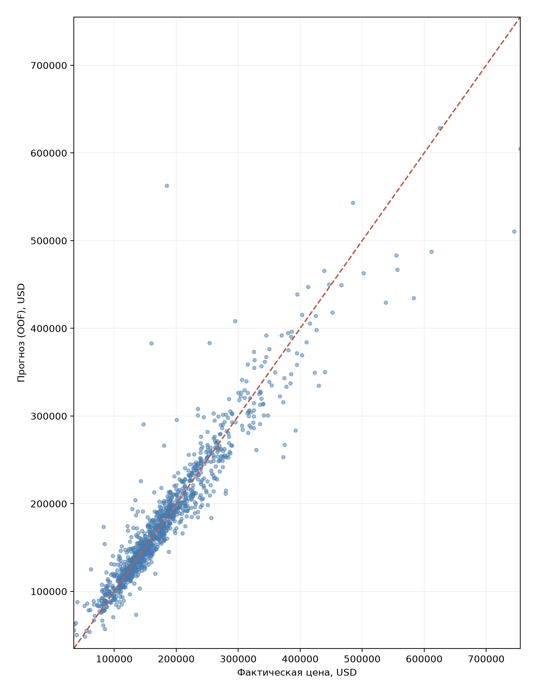

*Рисунок 3.3 - Фактические цены и OOF-прогнозы выбранной модели.*

На рисунке 3.3 большинство точек сосредоточено около диагонали идеального совпадения прогноза с фактической стоимостью. Это свидетельствует о сравнительно небольших ошибках для основной массы объектов. Одновременно видны отдельные значительные отклонения, особенно в области высоких цен. При этом каждая точка представляет прогноз для дома, который не входил в обучающий фолд соответствующей модели.

<details>
<summary>Код ячейки 18</summary>

```python
show_figure("3_4_oof_residuals.png", "Рисунок 3.4 — Остатки OOF-прогнозов относительно предсказанной цены.")
```

</details>

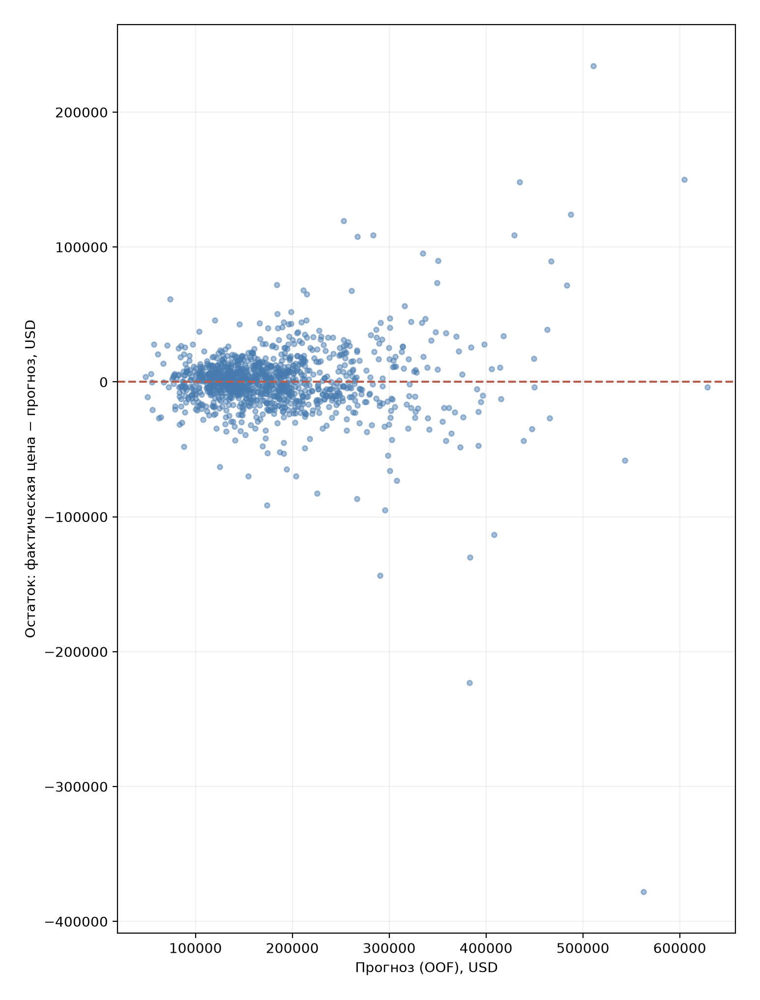

*Рисунок 3.4 - Остатки OOF-прогнозов относительно предсказанной цены.*

На рисунке 3.4 остаток рассчитывается как фактическая цена минус прогноз. Точки по обе стороны нулевой линии означают недооценку и переоценку недвижимости соответственно. Для основной группы домов ошибки относительно компактны, но с увеличением прогнозируемой стоимости разброс становится больше. Отдельные крупные остатки показывают, что модель значительно ошибается при оценке некоторых нетипичных объектов.

<details>
<summary>Код ячейки 20</summary>

```python
show_figure("3_5_oof_qq.png", "Рисунок 3.5 — Q-Q диаграмма распределения остатков OOF-прогнозов.")
```

</details>

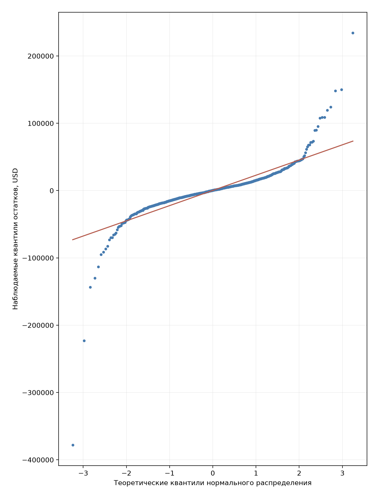

*Рисунок 3.5 - Q–Q диаграмма распределения остатков OOF-прогнозов.*

На рисунке 3.5 центральная часть точек расположена сравнительно близко к теоретической прямой нормального распределения, но в обоих хвостах заметны сильные отклонения. Это согласуется с наличием небольшого числа крупных ошибок, выявленных на предыдущих двух рисунках. Нормальность остатков не является обязательным условием применения XGBoost, поэтому график используется для диагностики распределения ошибок, а не для исключения алгоритма.

#### Совместная оценка прогнозов и остатков

Рисунки 3.3–3.5 показывают, что **XGBoost хорошо описывает большинство исторических сделок**, однако качество неоднородно и ухудшается на отдельных нетипичных и дорогих объектах. Большие отдельные ошибки сильнее влияют на RMSE, чем на MAE, поэтому эти показатели важно рассматривать совместно. Крупные отклонения и локальные вклады признаков подробнее рассматриваются в разделе интерпретации моделей.

<details>
<summary>Код ячейки 23</summary>

```python
oof = oof.assign(Absolute_Error=oof["Residual"].abs())
print("Максимальные абсолютные ошибки OOF (не внешний тест):")
display(oof.nlargest(5, "Absolute_Error")[["Id", "SalePrice", "OOF_Pred", "Residual", "Absolute_Error"]].round(1))
expensive = oof[oof["SalePrice"] >= 400_000]
regular = oof[oof["SalePrice"] < 400_000]
print(
    f"Дома от 400 000 USD: n={len(expensive)}, "
    f"MAE={expensive.Absolute_Error.mean():,.0f} USD, "
    f"остальные: n={len(regular)}, MAE={regular.Absolute_Error.mean():,.0f} USD."
)
print("Эти подгруппы выделены для диагностики, а не для настройки модели по OOF-результатам.")
```

</details>

```text
Максимальные абсолютные ошибки OOF (не внешний тест):
```

|  | Id | SalePrice | OOF_Pred | Residual | Absolute_Error |
| --- | --- | --- | --- | --- | --- |
| 940 | 524 | 184750.0 | 562757.4 | -378007.4 | 378007.4 |
| 1003 | 1183 | 745000.0 | 510658.7 | 234341.3 | 234341.3 |
| 607 | 1299 | 160000.0 | 383148.2 | -223148.2 | 223148.2 |
| 685 | 692 | 755000.0 | 604823.0 | 150177.0 | 150177.0 |
| 423 | 804 | 582933.0 | 434644.9 | 148288.1 | 148288.1 |

```text
Дома от 400 000 USD: n=24, MAE=63,465 USD, остальные: n=1144, MAE=13,944 USD.
Эти подгруппы выделены для диагностики, а не для настройки модели по OOF-результатам.
```

### Обучение MLP и ранняя остановка

Многослойный персептрон использует два скрытых слоя (64 и 32 нейрона), функцию активации ReLU, оптимизатор Adam и механизм Early Stopping. Обучение направлено на снижение Training Loss, рассчитанного по стандартизированной целевой переменной. Однако улучшение на обучающих данных не гарантирует роста Validation R². При ранней остановке сохраняются и затем восстанавливаются веса, соответствующие лучшему результату внутренней валидации.

<details>
<summary>Код ячейки 25</summary>

```python
show_figure("3_6_mlp_training.png", "Рисунок 3.6 — Training Loss и Validation R² нейросети MLP на полном внешнем train.")
```

</details>

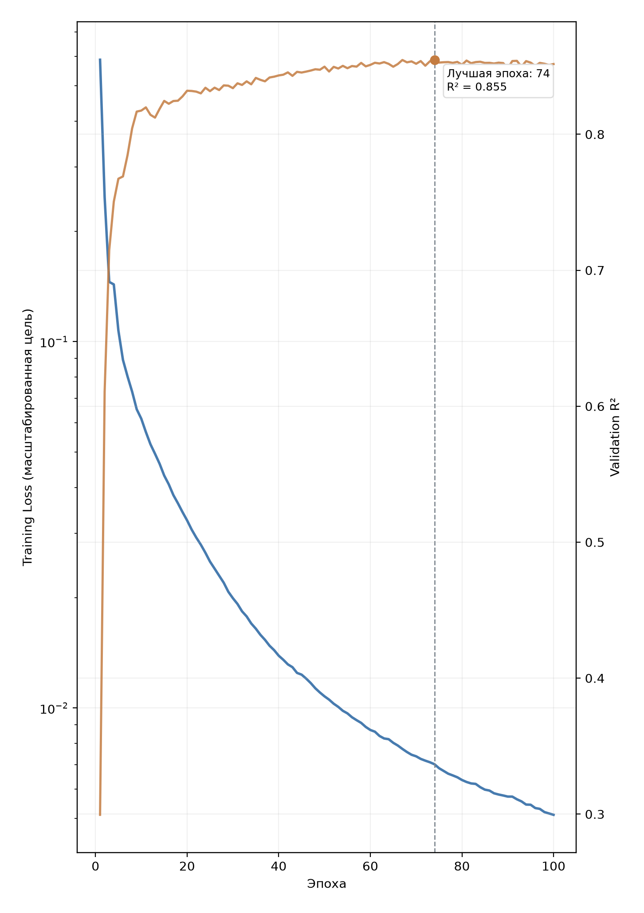

*Рисунок 3.6 - Training Loss и Validation R² нейросети MLP на полном внешнем train.*

<details>
<summary>Код ячейки 26</summary>

```python
import json
mlp_info_path = RESULTS / "mlp_training_summary.json"
if mlp_info_path.exists():
    mlp_info = json.loads(mlp_info_path.read_text(encoding="utf-8"))
    display(pd.DataFrame([{
        "Эпох выполнено": mlp_info["epochs_run"],
        "Лучшая эпоха": mlp_info["best_epoch"],
        "Loss первой эпохи": mlp_info["first_loss"],
        "Loss лучшей эпохи": mlp_info["best_epoch_loss"],
        "Loss последней эпохи": mlp_info["last_loss"],
        "Лучший Validation R²": mlp_info["best_validation_r2"],
        "Validation R² последней эпохи": mlp_info["last_validation_r2"],
    }]).round(5))
    best_r2 = mlp_info["best_validation_r2"]
    last_r2 = mlp_info["last_validation_r2"]
    if last_r2 < best_r2:
        explanation = (
            "После лучшей эпохи качество на внутренней валидации снизилось, "
            "хотя Training Loss к последней эпохе стал меньше. "
            "Это характерный признак переобучения или нестабильности качества."
        )
    else:
        explanation = "В последней эпохе достигнут лучший валидационный результат."
    display(Markdown(
        f"Нейросеть обучалась **{mlp_info['epochs_run']} эпох**, "
        f"наилучший Validation R² = **{best_r2:.4f}** достигнут "
        f"на **{mlp_info['best_epoch']}-й эпохе**. "
        f"К концу обучения Validation R² = **{last_r2:.4f}**. "
        + explanation + " Механизм Early Stopping сохраняет/восстанавливает "
        "лучшие веса, а `loss_` относится к последней эпохе, поэтому "
        "его нельзя считать ошибкой восстановленной модели. "
        "Это **не** история предыдущего самостоятельного эксперимента с 38 эпохами."
    ))
else:
    print("Нет mlp_training_summary.json. Запусти python main.py regression --refresh-plots — пересчитывать все CV-фолды не нужно.")
```

</details>

|  | Эпох выполнено | Лучшая эпоха | Loss первой эпохи | Loss лучшей эпохи | Loss последней эпохи | Лучший Validation R² | Validation R² последней эпохи |
| --- | --- | --- | --- | --- | --- | --- | --- |
| 0 | 100 | 74 | 0.58798 | 0.00702 | 0.00511 | 0.85482 | 0.85164 |

Нейросеть обучалась **100 эпох**, наилучший Validation R² = **0.8548** достигнут на **74-й эпохе**. К концу обучения Validation R² = **0.8516**. После лучшей эпохи качество на внутренней валидации снизилось, хотя Training Loss к последней эпохе стал меньше. Это характерный признак переобучения или нестабильности качества. Механизм Early Stopping сохраняет/восстанавливает лучшие веса, а `loss_` относится к последней эпохе, поэтому его нельзя считать ошибкой восстановленной модели. Это **не** история предыдущего самостоятельного эксперимента с 38 эпохами.

Сопоставление двух кривых на рисунке 3.6 показывает, почему завершать обучение только по минимальному Training Loss недостаточно. В данной версии MLP лучший валидационный результат был достигнут раньше последней эпохи, после чего функция потерь продолжала уменьшаться без соответствующего улучшения Validation R². Такой характер динамики указывает на риск переобучения и обосновывает использование Early Stopping. Результаты этого запуска не следует смешивать с первоначальным учебным экспериментом, в котором было выполнено 38 эпох.

### Внешний тест и редкий объект с бассейном

На внешнем тесте приведены те же метрики в USD, они не использовались для выбора алгоритма. Ранее выявленный дом с `PoolQC_Gd` и `SalePrice = 274970` представлен отдельно. В train категория `PoolQC_Gd` встречалась лишь у одного объекта. Нельзя заключить, что именно бассейн полностью объясняет ошибку какой-либо модели.

<details>
<summary>Код ячейки 29</summary>

```python
display(test_summary.round(3))
case_file = RESULTS / "rare_pool_case.csv"
if case_file.exists():
    rare_case = pd.read_csv(case_file)
    display(rare_case.sort_values("Abs_error_USD").round(2))
else:
    print("Нет ранее исследованного объекта в текущем тестовом разбиении.")
```

</details>

|  | Model | R2 | MAE | RMSE |
| --- | --- | --- | --- | --- |
| 0 | XGBoost | 0.894 | 14847.150 | 24370.473 |
| 1 | Lasso | 0.887 | 16371.889 | 25194.008 |
| 2 | Ridge | 0.896 | 16705.161 | 24209.832 |
| 3 | Random Forest | 0.871 | 18076.338 | 26978.115 |
| 4 | MLP | 0.875 | 18158.471 | 26547.345 |
| 5 | LinearRegression | 0.639 | 20134.919 | 45050.284 |
| 6 | DummyRegressor | -0.000 | 57678.271 | 75000.384 |

|  | Model | Id | Actual_USD | Pred_USD | Abs_error_USD |
| --- | --- | --- | --- | --- | --- |
| 6 | MLP | 1424 | 274970.0 | 282023.19 | 7053.19 |
| 2 | Ridge | 1424 | 274970.0 | 203450.09 | 71519.91 |
| 4 | Random Forest | 1424 | 274970.0 | 184588.50 | 90381.50 |
| 0 | DummyRegressor | 1424 | 274970.0 | 181210.55 | 93759.45 |
| 5 | XGBoost | 1424 | 274970.0 | 160275.66 | 114694.34 |
| 3 | Lasso | 1424 | 274970.0 | 110965.61 | 164004.39 |
| 1 | LinearRegression | 1424 | 274970.0 | 895067.14 | 620097.14 |

### Подбор параметров XGBoost

Подбор проведён методом **RandomizedSearchCV** на трёх фолдах внешней обучающей выборки. Целевая метрика поиска - MAE в USD, минимизация ошибки. Перебираются `n_estimators` (количество деревьев), `max_depth` (сложность каждого дерева), `learning_rate` (шаг бустинга), `subsample` (доля объектов), `colsample_bytree` (доля признаков), `min_child_weight` (минимальные требования к разделению) и `reg_lambda` (L2-штраф).

Небольшая глубина 2–4 и `min_child_weight` 1–5 ограничивают сложность на небольшом датасете, шаг 0.025–0.08 и 200–450 деревьев позволяют сравнить медленное/быстрое обучение, подвыборки строк/признаков и `reg_lambda` помогают бороться с переобучением. Выбор диапазонов - инженерная гипотеза, а не гарантия оптимума.

В полном пространстве **2187** комбинаций, текущий пробный поиск изучил только **8**, поэтому результат не следует считать глобальным оптимумом. Трёхфолдовая MAE победителя по использованным при поиске разбиениям потенциально оптимистична. Значения из пятифолдовой CV относятся к **базовой**, а не автоматически к подобранной конфигурации.

<details>
<summary>Код ячейки 31</summary>

```python
params_path = RESULTS / "xgboost_tuning.json"
trials_path = RESULTS / "xgboost_tuning_trials.csv"
if params_path.exists():
    config = json.loads(params_path.read_text(encoding="utf-8"))
    best_params = {key.removeprefix("model__"): val
                   for key, val in config["best_params"].items()}
    base_params = {
        "n_estimators": 300, "max_depth": 3, "learning_rate": 0.05,
        "subsample": 0.8, "colsample_bytree": 0.8,
        "min_child_weight": 1, "reg_lambda": 1.0,
    }
    param_names = list(base_params)
    display(pd.DataFrame({
        "Параметр": param_names,
        "Базовая": [base_params[k] for k in param_names],
        "Выбранная": [best_params.get(k) for k in param_names],
    }))
    print(f"Лучшая MAE в 3-Fold поиске: {config['cv3_mae_usd']:,.2f} USD")
    print("При подборе использовано 8 случайных комбинаций из 2187 возможных.")
    if trials_path.exists():
        trials = pd.read_csv(trials_path)
        best_trials = trials.nsmallest(5, "rank_test_score")
        display(pd.DataFrame({
            "Ранг": best_trials["rank_test_score"],
            "MAE (3-Fold), USD": -best_trials["mean_test_score"],
            "Std MAE, USD": best_trials["std_test_score"],
            "Параметры": best_trials["params"],
        }).round(2))
    display(Markdown(
        "Среди исследованных конфигураций выбрана конфигурация с меньшим шагом обучения, "
        "большим количеством деревьев и глубиной 4 вместо 3. Это **результат поиска** "
        "по выбранной метрике, а не доказательство независимого прироста качества. "
        "В дальнейших экспериментах сравним базовую и настроенную модели "
        "на одинаковых новых валидационных разбиениях либо через вложенную CV."
    ))
else:
    print("Подбор не выполнялся. Для запуска: python main.py regression --tune-xgb")
```

</details>

|  | Параметр | Базовая | Выбранная |
| --- | --- | --- | --- |
| 0 | n_estimators | 300.00 | 450.000 |
| 1 | max_depth | 3.00 | 4.000 |
| 2 | learning_rate | 0.05 | 0.025 |
| 3 | subsample | 0.80 | 0.750 |
| 4 | colsample_bytree | 0.80 | 1.000 |
| 5 | min_child_weight | 1.00 | 1.000 |
| 6 | reg_lambda | 1.00 | 1.000 |

```text
Лучшая MAE в 3-Fold поиске: 14,967.88 USD
При подборе использовано 8 случайных комбинаций из 2187 возможных.
```

|  | Ранг | MAE (3-Fold), USD | Std MAE, USD | Параметры |
| --- | --- | --- | --- | --- |
| 4 | 1 | 14967.88 | 989.67 | {'model__subsample': 0.75, 'model__reg_lambda'... |
| 3 | 2 | 15426.67 | 1142.43 | {'model__subsample': 0.75, 'model__reg_lambda'... |
| 5 | 3 | 15551.46 | 1023.54 | {'model__subsample': 0.75, 'model__reg_lambda'... |
| 2 | 4 | 15611.57 | 639.13 | {'model__subsample': 1.0, 'model__reg_lambda':... |
| 6 | 5 | 15875.23 | 1085.94 | {'model__subsample': 0.9, 'model__reg_lambda':... |

Среди исследованных конфигураций выбрана конфигурация с меньшим шагом обучения, большим количеством деревьев и глубиной 4 вместо 3. Это **результат поиска** по выбранной метрике, а не доказательство независимого прироста качества. В дальнейших экспериментах сравним базовую и настроенную модели на одинаковых новых валидационных разбиениях либо через вложенную CV.

### Итоговые выводы

В ходе исследования разработаны и сопоставлены регрессионные модели
для прогнозирования исторической стоимости жилой недвижимости
на основе характеристик объектов. Исходный набор данных содержит
1 460 наблюдений, из которых 1 168 использованы для обучения
и валидации, а 292 выделены в отдельную тестовую выборку.

Проведено сравнение DummyRegressor, LinearRegression, Ridge, Lasso,
Random Forest, XGBoost и многослойного персептрона (MLP).
Качество прогнозирования оценивалось с использованием MAE, RMSE
и коэффициента детерминации R². Для проверки устойчивости моделей
применена пятикратная кросс-валидация с независимой предобработкой
данных внутри каждого разбиения, что исключает использование
статистик валидационных объектов при обучении преобразований.

Наиболее высокое качество в проведённом сравнении продемонстрировала
модель XGBoost. Средний коэффициент детерминации составил 0,8903,
средняя абсолютная ошибка составила 14 959 USD, а RMSE (корень из средней квадратичной ошибки) - 25 786 USD. Random Forest также показал
устойчивые результаты, однако уступил XGBoost по основным метрикам.
Линейная регрессия без регуляризации характеризовалась выраженной
нестабильностью качества между разбиениями, что согласуется
с выявленной ранее мультиколлинеарностью признаков.

Анализ прогнозов и остатков показал, что наибольшие отклонения
могут возникать при оценке объектов с нетипичными характеристиками
и высокой стоимостью. Распределение ошибок содержит выраженные
хвосты, что указывает на необходимость учитывать не только
усреднённые метрики, но и отдельные случаи существенных отклонений.
При этом отклонение распределения остатков от нормального
не является самостоятельным основанием для отклонения модели.

Для XGBoost выполнен подбор гиперпараметров с использованием
RandomizedSearchCV и минимизации MAE. Полученная конфигурация
рассматривается как результат ограниченного поиска, а не как
гарантированно оптимальное решение. Дополнительно исследовано
обучение многослойного персептрона, включая динамику функции
потерь, изменение качества на валидационной выборке и применение
механизма ранней остановки для ограничения переобучения.

Таким образом, XGBoost выбран в качестве основного кандидата
для дальнейшего исследования благодаря сочетанию высокой
точности прогнозирования и сравнительно устойчивого качества
на разных разбиениях данных. Дальнейший анализ предусматривает
исследование значимости характеристик недвижимости, объяснение
отдельных прогнозов и оценку ограничений выбранной модели.

<details>
<summary>Код ячейки 33</summary>

```python
leader = cv_summary.iloc[0]
runner = cv_summary.iloc[1]
print(
    f"Для дальнейшего исследования выбрана модель {leader.Model}. "
    f"На 5-Fold CV: MAE = {leader.MAE_mean:,.2f} USD, "
    f"RMSE = {leader.RMSE_mean:,.2f} USD, "
    f"R² = {leader.R2_mean:.4f} ± {leader.R2_std:.4f} (std между фолдами). "
    f"Ближайший конкурент по MAE — {runner.Model} "
    f"({runner.MAE_mean:,.2f} USD)."
)
print(
    "Это предварительный выбор по CV базовых конфигураций. Подбор XGBoost "
    "выполнен отдельно, не выдаём его 3-Fold score за независимое подтверждение."
)
```

</details>

```text
Для дальнейшего исследования выбрана модель XGBoost. На 5-Fold CV: MAE = 14,959.33 USD, RMSE = 25,785.50 USD, R² = 0.8903 ± 0.0488 (std между фолдами). Ближайший конкурент по MAE — Random Forest (16,937.10 USD).
Это предварительный выбор по CV базовых конфигураций. Подбор XGBoost выполнен отдельно, не выдаём его 3-Fold score за независимое подтверждение.
```

## 4. Классификация ценового сегмента жилой недвижимости

**Цель исследования** - сопоставить классификаторы, определяющие принадлежность объекта к сегменту стоимости от 200 000 USD. Целевая переменная принимает значение `1` для дорогого сегмента и `0` для остальных объектов.

Для оценки использованы DummyClassifier, LogisticRegression, RandomForestClassifier, XGBoostClassifier и MLPClassifier. При сравнении рассматриваются Accuracy, Balanced Accuracy, Precision, Recall, F1 и ROC-AUC. Значимость признаков и объяснение отдельных прогнозов изучаются на следующем этапе исследования.

### Методика оценки

Для сохранения доли положительного класса применяется `StratifiedKFold` с пятью разбиениями. В каждом разбиении предобработка исходных характеристик обучается только на соответствующей тренировочной части, что предотвращает утечку информации из валидационных объектов при заполнении пропусков, IQR-обработке, стандартизации и категориальном кодировании.

OOF-прогнозы формируются по одному разу для каждого объекта. Они используются для построения кривых ROC и Precision–Recall и матриц ошибок. При этом метрики, рассчитанные на объединённых OOF-прогнозах, могут немного отличаться от среднего по пяти фолдам. Внешняя тестовая выборка на данном этапе не используется.

<details>
<summary>Код ячейки 3</summary>

```python
from pathlib import Path
import json
import pandas as pd
import numpy as np
from IPython.display import Image, display
from sklearn.metrics import confusion_matrix, f1_score, roc_auc_score, average_precision_score

ROOT = Path.cwd().resolve()
if ROOT.name == "notebooks":
    ROOT = ROOT.parent
RESULTS = ROOT / "outputs" / "classification"

required = ["cv_summary.csv", "cv_folds.csv", "oof_models.csv", "mlp_learning_history.csv"]
missing = [name for name in required if not (RESULTS / name).exists()]
if missing:
    raise FileNotFoundError(f"Не найдены результаты {missing}. Запустите python main.py classification из корня проекта")
summary = pd.read_csv(RESULTS / "cv_summary.csv")
folds = pd.read_csv(RESULTS / "cv_folds.csv")
oof = pd.read_csv(RESULTS / "oof_models.csv")
mlp_history = pd.read_csv(RESULTS / "mlp_learning_history.csv")
mlp_details = json.loads((RESULTS / "mlp_training_summary.json").read_text(encoding="utf-8"))
display(summary[["Model","Accuracy_mean","Precision_mean","Recall_mean","F1_mean","ROC_AUC_mean"]].round(4))
```

</details>

|  | Model | Accuracy_mean | Precision_mean | Recall_mean | F1_mean | ROC_AUC_mean |
| --- | --- | --- | --- | --- | --- | --- |
| 0 | XGBoostClassifier | 0.9401 | 0.9071 | 0.8910 | 0.8977 | 0.9825 |
| 1 | MLPClassifier | 0.9350 | 0.9034 | 0.8766 | 0.8892 | 0.9792 |
| 2 | LogisticRegression | 0.9289 | 0.8861 | 0.8765 | 0.8808 | 0.9746 |
| 3 | RandomForestClassifier | 0.9238 | 0.9114 | 0.8251 | 0.8646 | 0.9802 |
| 4 | DummyClassifier | 0.7021 | 0.0000 | 0.0000 | 0.0000 | 0.5000 |

Таблица 4.1 - средние метрики пяти классификаторов при исходных конфигурациях. Показатели рассматриваются совместно, поскольку Accuracy недостаточно при дисбалансе классов.

### Состав ценовых сегментов

<details>
<summary>Код ячейки 5</summary>

```python
display(Image(filename=str(RESULTS / "figures" / "4_1_class_distribution.png")))
```

</details>

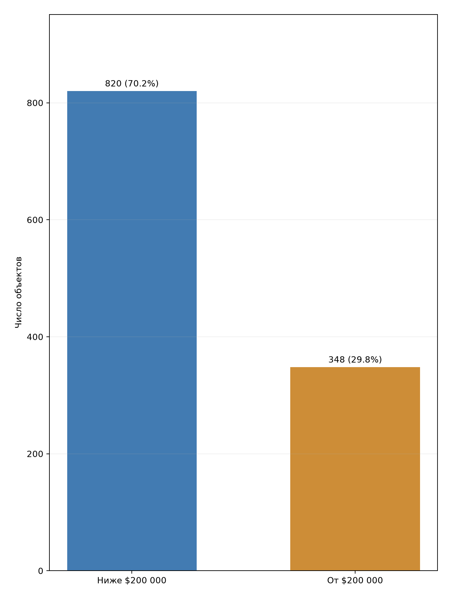

*Рисунок 4.1 - Распределение наблюдений по ценовым сегментам.*

Положительный класс составляет около 30% обучающих наблюдений, поэтому общая доля правильных решений не может служить единственным критерием качества. Для выявления дорогих объектов необходимо отдельно учитывать Precision и Recall. Пятикратная стратификация сохраняет приблизительно одинаковую представленность классов в разных разбиениях.

### Сравнение качества классификаторов

<details>
<summary>Код ячейки 8</summary>

```python
display(Image(filename=str(RESULTS / "figures" / "4_2_comparison_metrics.png")))
```

</details>

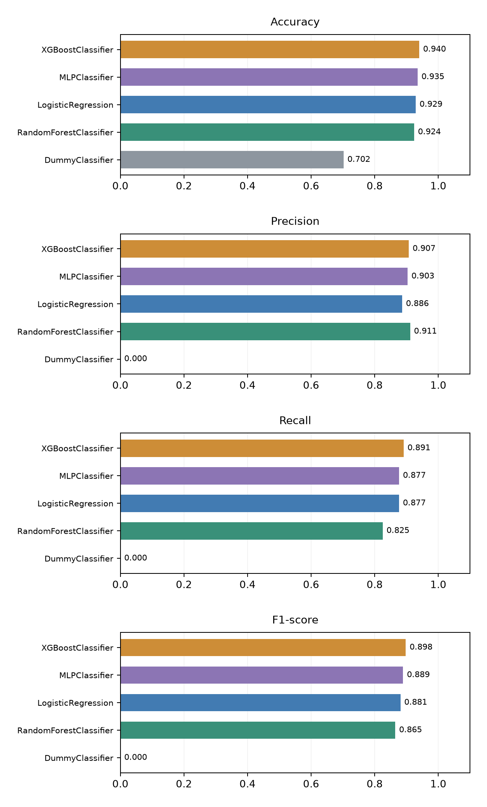

*Рисунок 4.2 - Сравнение Accuracy, Precision, Recall и F1-score по пяти разбиениям.*

Диаграмма показывает различия средних Accuracy, Precision, Recall и F1. Способность ранжировать объекты по вероятности положительного класса оценивается отдельно по ROC-AUC. DummyClassifier показывает формально приемлемую Accuracy за счёт преобладающего класса, но имеет нулевой F1, поскольку не находит дорогие дома. Показатель ROC-AUC отдельно характеризует способность упорядочивать объекты по вероятности положительного класса, поэтому рейтинг по нему может отличаться от рейтинга по F1.

Сравнение проводилось при исходных настройках алгоритмов и стандартном пороге принятия решения. Малые различия средних метрик сами по себе не доказывают статистически значимого превосходства.

<details>
<summary>Код ячейки 10</summary>

```python
display(summary[["Model", "Accuracy_mean", "BalancedAccuracy_mean", "Precision_mean", "Recall_mean", "F1_mean", "ROC_AUC_mean"]].round(4))
display(folds.pivot(index="Fold", columns="Model", values="F1").round(4))
best = summary.iloc[0]
print(f"Наибольший средний F1: {best['Model']} = {best['F1_mean']:.4f}")
```

</details>

|  | Model | Accuracy_mean | BalancedAccuracy_mean | Precision_mean | Recall_mean | F1_mean | ROC_AUC_mean |
| --- | --- | --- | --- | --- | --- | --- | --- |
| 0 | XGBoostClassifier | 0.9401 | 0.9260 | 0.9071 | 0.8910 | 0.8977 | 0.9825 |
| 1 | MLPClassifier | 0.9350 | 0.9182 | 0.9034 | 0.8766 | 0.8892 | 0.9792 |
| 2 | LogisticRegression | 0.9289 | 0.9139 | 0.8861 | 0.8765 | 0.8808 | 0.9746 |
| 3 | RandomForestClassifier | 0.9238 | 0.8955 | 0.9114 | 0.8251 | 0.8646 | 0.9802 |
| 4 | DummyClassifier | 0.7021 | 0.5000 | 0.0000 | 0.0000 | 0.0000 | 0.5000 |

| Model | DummyClassifier | LogisticRegression | MLPClassifier | RandomForestClassifier | XGBoostClassifier |
| --- | --- | --- | --- | --- | --- |
| Fold |  |  |  |  |  |
| 1 | 0.0 | 0.8794 | 0.8571 | 0.8333 | 0.8811 |
| 2 | 0.0 | 0.8971 | 0.9078 | 0.8824 | 0.9296 |
| 3 | 0.0 | 0.8489 | 0.8613 | 0.8065 | 0.8372 |
| 4 | 0.0 | 0.9254 | 0.9403 | 0.8971 | 0.9420 |
| 5 | 0.0 | 0.8531 | 0.8794 | 0.9037 | 0.8986 |

```text
Наибольший средний F1: XGBoostClassifier = 0.8977
```

Таблицы 4.2 и 4.3 - сопоставление средних метрик и значений F1 по фолдам. Различия между разбиениями учитываются при выборе кандидата.

### Анализ ошибок классификации

<details>
<summary>Код ячейки 12</summary>

```python
display(Image(filename=str(RESULTS / "figures" / "4_3_confusion_matrices.png")))
```

</details>

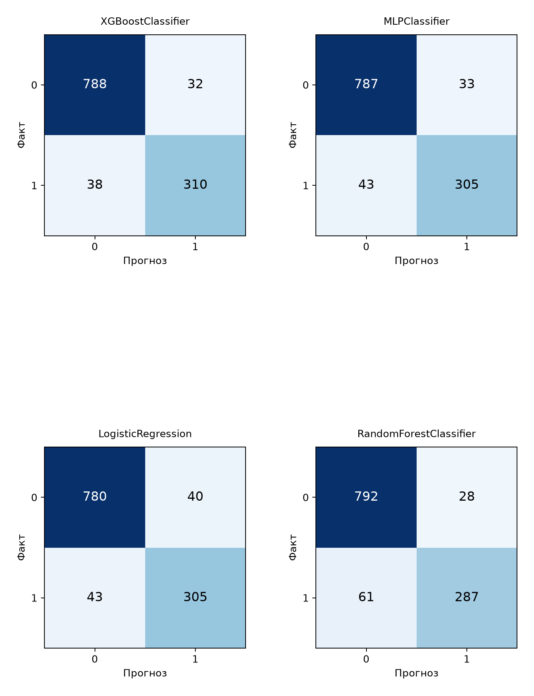

*Рисунок 4.3 - Матрицы ошибок четырёх обучаемых классификаторов на объединённых OOF-прогнозах.*

По горизонтали указан предсказанный класс, по вертикали - фактический. Ошибка FP соответствует отнесению недорогого дома к дорогому сегменту, ошибка FN означает пропуск действительно дорогого объекта. Сопоставление матриц показывает, что модель с максимальным Precision может пропускать больше объектов положительного класса. Поэтому при выборе классификатора следует учитывать баланс разных типов ошибок.

<details>
<summary>Код ячейки 14</summary>

```python
rows=[]
for name in summary["Model"]:
    if name == "DummyClassifier":
        continue
    true = oof["ActualClass"].to_numpy()
    pred = oof[f"PredictedClass__{name}"].to_numpy()
    tn, fp, fn, tp = confusion_matrix(true, pred, labels=[0, 1]).ravel()
    rows.append({"Модель":name, "TN":tn, "FP":fp, "FN":fn, "TP":tp,
                 "OOF F1":f1_score(true,pred)})
display(pd.DataFrame(rows).round(4))
```

</details>

|  | Модель | TN | FP | FN | TP | OOF F1 |
| --- | --- | --- | --- | --- | --- | --- |
| 0 | XGBoostClassifier | 788 | 32 | 38 | 310 | 0.8986 |
| 1 | MLPClassifier | 787 | 33 | 43 | 305 | 0.8892 |
| 2 | LogisticRegression | 780 | 40 | 43 | 305 | 0.8802 |
| 3 | RandomForestClassifier | 792 | 28 | 61 | 287 | 0.8658 |

Таблица 4.4 - показатели ошибок классификации для рассмотренных алгоритмов. Их дополняют матрицы ошибок и кривые изменения порога.

### Сравнение ранжирования объектов

<details>
<summary>Код ячейки 16</summary>

```python
display(Image(filename=str(RESULTS / "figures" / "4_4_roc_comparison.png")))
```

</details>

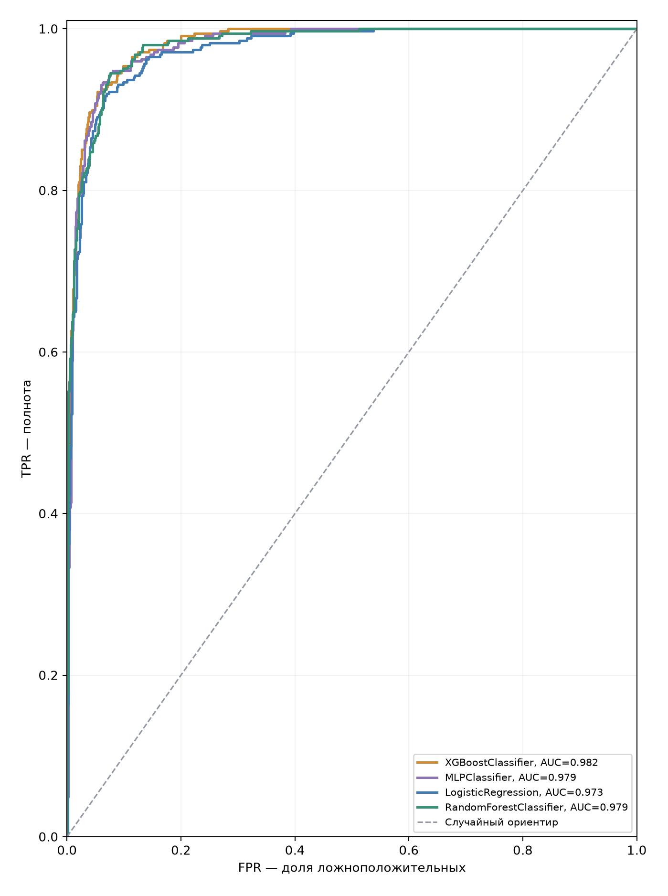

*Рисунок 4.4 - ROC-кривые обучаемых классификаторов по объединённым OOF-вероятностям.*

ROC-кривая показывает соотношение доли верно найденных положительных объектов и ложноположительных решений при изменении порога. Чем ближе кривая к левому верхнему углу, тем лучше разделение классов. Значения AUC в легенде рассчитаны по всем OOF-прогнозам, а не как среднее AUC по разбиениям.

<details>
<summary>Код ячейки 18</summary>

```python
display(Image(filename=str(RESULTS / "figures" / "4_5_precision_recall.png")))
```

</details>

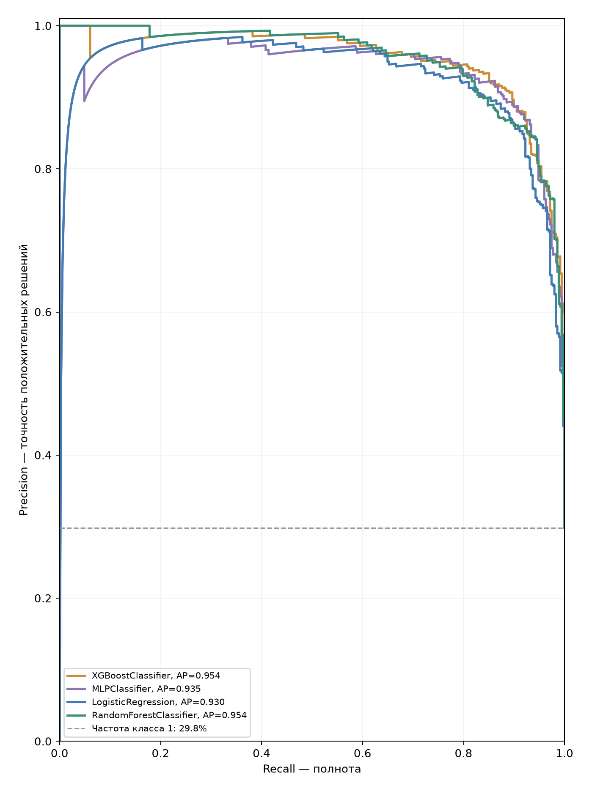

*Рисунок 4.5 - Кривые Precision–Recall по объединённым OOF-вероятностям.*

При увеличении полноты обнаружения дорогих домов обычно приходится допускать больше ложноположительных решений. Поэтому Precision–Recall-кривые позволяют оценить компромисс между пропусками и ложными срабатываниями. Горизонтальная линия соответствует доле положительного класса. В легенде представлена Average Precision (AP), которая не тождественна площади ROC-кривой.

**Общий вывод по рисункам 4.3-4.5.** Матрицы ошибок описывают решения при фиксированном пороге, а ROC и Precision-Recall характеризуют поведение модели при его изменении. Поэтому оценка качества требует совместного рассмотрения обоих подходов.

### Динамика обучения нейросетевого классификатора

<details>
<summary>Код ячейки 21</summary>

```python
display(Image(filename=str(RESULTS / "figures" / "4_6_mlp_training.png")))
```

</details>

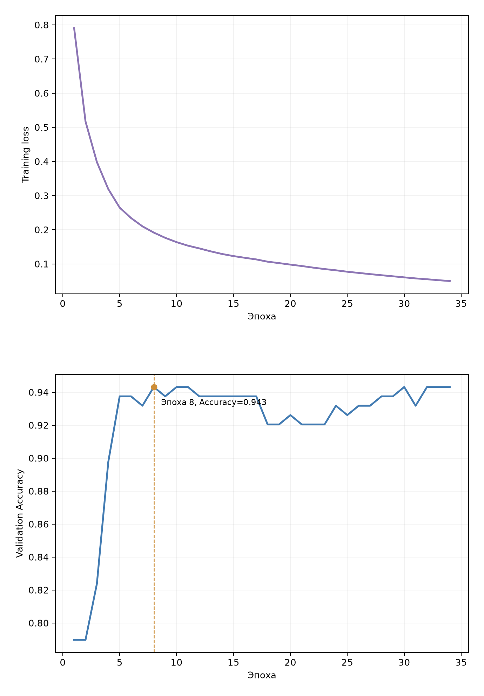

*Рисунок 4.6 - Динамика Training Loss и внутренней Validation Accuracy многослойного персептрона.*

Нейросеть обучается методом обратного распространения ошибки с оптимизатором Adam. По мере обучения функция потерь на тренировочной части обычно уменьшается, но качество на внутренней валидации может достичь максимума раньше окончания обучения. Механизм Early Stopping ориентируется здесь на **Validation Accuracy**, а не на F1 или ROC-AUC. Значения на рисунке получены при отдельном обучении на полном внешнем train и не являются историей пятифолдовой кросс-валидации. Поскольку внутренняя валидация MLP создаётся после подгонки общей предобработки, её Accuracy служит критерием остановки, а не независимой оценкой качества на новых данных.

<details>
<summary>Код ячейки 23</summary>

```python
print(f"Всего эпох: {mlp_details['epochs']}")
print(f"Лучшая эпоха: {mlp_details['best_epoch']}")
print(f"Лучшая внутренняя Validation Accuracy: {mlp_details['best_validation_accuracy']:.4f}")
print(f"Loss в начале и конце обучения: {mlp_details['first_training_loss']:.5f} → {mlp_details['last_training_loss']:.5f}")
```

</details>

```text
Всего эпох: 34
Лучшая эпоха: 8
Лучшая внутренняя Validation Accuracy: 0.9432
Loss в начале и конце обучения: 0.79037 → 0.04991
```

### Подбор гиперпараметров XGBoost

Для экспериментального подбора применяется `RandomizedSearchCV`. Критерий выбора - средний F1 в трёхфолдовой стратифицированной кросс-валидации, предобработка входит в каждый обучаемый Pipeline. Исследуются число деревьев, глубина, скорость обучения, доля используемых наблюдений и признаков, минимальный вес узла и коэффициент L2-регуляризации.

Увеличение числа деревьев при меньшем `learning_rate` позволяет делать более мелкие последовательные корректировки. Ограничение `max_depth` сдерживает сложность отдельных деревьев, `subsample` и `colsample_bytree` вносят стохастичность, а `min_child_weight` и `reg_lambda` регулируют сложность и величины обновлений. Найденные параметры являются лучшими **среди опробованных комбинаций**, но не гарантированно оптимальными. Диапазоны поиска ограничены исходной конфигурацией модели и разумной сложностью деревьев для небольшого набора данных.

| Гиперпараметр | Исследуемые значения |
|---|---|
| `n_estimators` | 200, 300, 450 |
| `max_depth` | 2, 3, 4 |
| `learning_rate` | 0.025, 0.05, 0.08 |
| `subsample` | 0.75, 0.9, 1.0 |
| `colsample_bytree` | 0.75, 0.9, 1.0 |
| `min_child_weight` | 1, 3, 5 |
| `reg_lambda` | 1.0, 3.0, 6.0 |

<details>
<summary>Код ячейки 25</summary>

```python
tuning_file = RESULTS / "xgboost_tuning.json"
trials_file = RESULTS / "xgboost_tuning_trials.csv"
if tuning_file.is_file() and trials_file.is_file():
    tuning = json.loads(tuning_file.read_text(encoding="utf-8"))
    print("Лучший F1 по внутреннему поиску:", round(tuning["search_cv_f1"], 4))
    display(pd.DataFrame([tuning["best_params"]]).T.rename(columns={0:"Значение"}))
    trials = pd.read_csv(trials_file)
    columns = [c for c in ["rank_test_score", "mean_test_score", "std_test_score",
                           "param_model__n_estimators", "param_model__max_depth",
                           "param_model__learning_rate", "param_model__subsample"] if c in trials]
    display(trials.sort_values("rank_test_score")[columns].head(5))
else:
    print("Подбор ещё не выполнялся. Из корня проекта запустите: python main.py classification --tune-only")
```

</details>

```text
Лучший F1 по внутреннему поиску: 0.8917
```

|  | Значение |
| --- | --- |
| subsample | 0.750 |
| reg_lambda | 1.000 |
| n_estimators | 450.000 |
| min_child_weight | 1.000 |
| max_depth | 4.000 |
| learning_rate | 0.025 |
| colsample_bytree | 1.000 |

|  | rank_test_score | mean_test_score | std_test_score | param_model__n_estimators | param_model__max_depth | param_model__learning_rate | param_model__subsample |
| --- | --- | --- | --- | --- | --- | --- | --- |
| 4 | 1 | 0.891715 | 0.006814 | 450 | 4 | 0.025 | 0.75 |
| 7 | 2 | 0.887917 | 0.003251 | 450 | 2 | 0.080 | 1.00 |
| 0 | 3 | 0.886543 | 0.010375 | 450 | 3 | 0.025 | 1.00 |
| 6 | 4 | 0.877193 | 0.012405 | 200 | 4 | 0.050 | 0.90 |
| 3 | 5 | 0.876285 | 0.008822 | 300 | 3 | 0.050 | 0.75 |

Результат подбора нельзя трактовать как независимую оценку качества настроенной модели. Для окончательной проверки полезности подобранных параметров требуется повторная оценка на отдельных валидационных разбиениях либо вложенная кросс-валидация. Внешняя тестовая выборка не должна использоваться для выбора параметров.

Таблицы 4.5 и 4.6 - параметры ограниченного поиска XGBoost и лучшие испытанные конфигурации. Результаты подбора не являются независимой оценкой качества.

### Итоговые выводы

Для определения ценового сегмента недвижимости проведено сравнение пяти алгоритмов, включая константный ориентир, линейный классификатор, ансамбли деревьев решений и многослойный персептрон. Применена пятикратная стратифицированная кросс-валидация с независимой предобработкой каждого разбиения, что позволяет сопоставлять модели на одинаковых наблюдениях без утечки статистик валидационной части.

Качество моделей рассматривается по совокупности Precision, Recall, F1, ROC-AUC и Balanced Accuracy. Сопоставление матриц ошибок выявляет различия в склонности алгоритмов пропускать дорогостоящие объекты или ошибочно относить недорогие дома к дорогому сегменту. Совместный анализ ROC- и Precision–Recall-кривых дополняет метрики при фиксированном пороге классификации.

Дополнительно изучены настройки градиентного бустинга и динамика обучения нейросетевого классификатора. Основного кандидата можно выбрать по среднему F1 при условии, что одновременно учитываются Recall, Precision и характер ошибок. Преимущество по одной метрике не подтверждает универсальное превосходство модели. Следующий этап исследования предусматривает анализ значимости характеристик и объяснение отдельных решений моделей.

<details>
<summary>Код ячейки 28</summary>

```python
leader = summary.iloc[0]
print(f"Основной кандидат по среднему F1: {leader['Model']}")
print(f"F1={leader['F1_mean']:.4f}, ROC-AUC={leader['ROC_AUC_mean']:.4f}, Recall={leader['Recall_mean']:.4f}")
print("Оценки получены на CV обучающей выборки. Внешний test не участвовал в сравнении.")
```

</details>

```text
Основной кандидат по среднему F1: XGBoostClassifier
F1=0.8977, ROC-AUC=0.9825, Recall=0.8910
Оценки получены на CV обучающей выборки. Внешний test не участвовал в сравнении.
```

## 5. Интерпретация моделей стоимости недвижимости

**Цель** - объяснить, какие характеристики используются алгоритмами прогнозирования цены и принадлежности к ценовому сегменту, сравнить глобальную важность признаков в Random Forest и XGBoost и исследовать локальные SHAP-вклады.

Признаки описывают наблюдаемые свойства домов, поэтому «важность» и «вклад в прогноз» **не являются доказательством причинного влияния на рыночную цену**.

На этом этапе используются ранее обученные XGBoost, а Random Forest обучается на тех же тренировочных объектах исключительно для сравнения. Внешняя тестовая часть применяется для **описательной интерпретации** прогнозов, но не для подбора гиперпараметров.

### Методика и подготовка результатов

**Feature Importance (важность признаков)** показывает, насколько активно модель использует характеристику при обучении. В Random Forest применяется уменьшение неоднородности, а XGBoost по умолчанию предоставляет нормированную важность на основе выигрыша разделений (`gain`). Числа между алгоритмами нельзя непосредственно считать одной и той же физической величиной.

**SHAP (аддитивные объяснения по значениям Шепли)** представляет отдельный прогноз как сумму базового значения и вкладов характеристик. Для регрессии вклады измеряются в долларах США, а для классификации XGBoost используются на шкале *log-odds* (логарифма отношения шансов). Для получения вероятности применяется логистическая функция.

Ни один вывод не строится на будущем целевом значении как на входном признаке. В рамках описательного анализа уже изученная внешняя тестовая выборка не рассматривается как новая независимая оценка качества.

<details>
<summary>Код ячейки 3</summary>

```python
from pathlib import Path
import json
import os
import webbrowser
import pandas as pd
from IPython.display import Image, display

try:
    import ipywidgets as widgets
except ImportError:
    widgets = None

ROOT = Path.cwd().resolve()
if ROOT.name == "notebooks":
    ROOT = ROOT.parent
RESULTS = ROOT / "outputs" / "explainability"
required = ["importance_regression_xgboost.csv", "importance_classification_xgboost.csv",
            "shap_global_regression.csv", "shap_global_classification.csv",
            "local_regression.json", "local_classification.json"]
missing = [name for name in required if not (RESULTS / name).is_file()]
if missing:
    raise FileNotFoundError(f"Не найдены результаты {missing}. Сначала выполните python main.py explainability")

local_reg = json.loads((RESULTS / "local_regression.json").read_text(encoding="utf-8"))
local_clf = json.loads((RESULTS / "local_classification.json").read_text(encoding="utf-8"))
print("Дом для локальной регрессии:", local_reg["Id"])
print("Дом для локальной классификации:", local_clf["Id"])


def open_force_plot(filename: str) -> None:
    """Открыть локальный SHAP HTML в браузере по умолчанию.

    Работает на компьютере, на котором запущено ядро Python (Jupyter kernel).
    """
    path = (RESULTS / filename).resolve()
    if not path.is_file():
        raise FileNotFoundError(f"HTML Force Plot не найден: {path}")
    if path.suffix.lower() != ".html":
        raise ValueError("Ожидается HTML-файл Force Plot")

    launched = webbrowser.open_new_tab(path.as_uri())
    if not launched and os.name == "nt":
        # Запасной вариант Windows: открытие по назначенному приложению .html.
        os.startfile(str(path))
        launched = True
    if not launched:
        raise RuntimeError(
            "Не удалось открыть браузер. Откройте файл напрямую: " + str(path)
        )


def show_force_plot_button(filename: str, title: str) -> None:
    """Кнопка с запуском по нажатию, без открытия вкладок при Run All."""
    if widgets is None:
        print("Для кнопки установите ipywidgets: python -m pip install ipywidgets")
        print(f"Без кнопки выполните в отдельной ячейке: open_force_plot({filename!r})")
        return

    button = widgets.Button(
        description=title,
        icon="external-link",
        tooltip="Открыть локальный SHAP HTML в браузере по умолчанию",
        layout=widgets.Layout(width="auto"),
    )
    status = widgets.Output()

    def _on_click(_):
        with status:
            status.clear_output(wait=True)
            try:
                open_force_plot(filename)
            except Exception as exc:
                print(f"Ошибка открытия Force Plot: {exc}")

    button.on_click(_on_click)
    display(widgets.VBox([button, status]))
```

</details>

```text
Дом для локальной регрессии: 1424
Дом для локальной классификации: 1051
```

### Сопоставление встроенной важности: регрессия

<details>
<summary>Код ячейки 5</summary>

```python
display(Image(filename=str(RESULTS / "figures" / "5_1_importance_regression.png")))
```

</details>

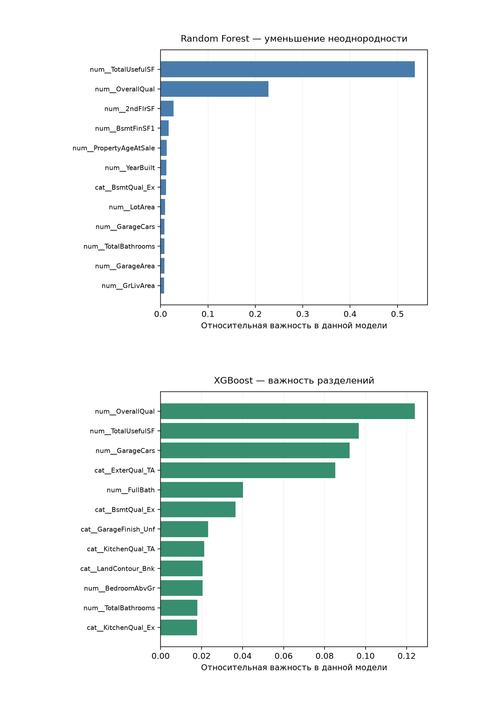

*Рисунок 5.1 - Относительная важность характеристик для Random Forest и XGBoost в прогнозировании стоимости.*

На рисунке сравниваются первые 12 признаков для двух ансамблевых алгоритмов. Важно различать ранжирование внутри каждой модели и относительный масштаб показателя. Если один и тот же признак находится высоко в обоих списках, он активно используется обеими моделями, но это не говорит о независимом причинном эффекте. Сильные корреляции могут перераспределять важность между связанными характеристиками.

<details>
<summary>Код ячейки 7</summary>

```python
rf_r = pd.read_csv(RESULTS / "importance_regression_random_forest.csv")
xgb_r = pd.read_csv(RESULTS / "importance_regression_xgboost.csv")
print("Random Forest — ведущие признаки")
display(rf_r.head(8))
print("XGBoost — ведущие признаки")
display(xgb_r.head(8))
```

</details>

```text
Random Forest — ведущие признаки
```

|  | Feature | Importance |
| --- | --- | --- |
| 0 | num__TotalUsefulSF | 0.536748 |
| 1 | num__OverallQual | 0.227881 |
| 2 | num__2ndFlrSF | 0.027350 |
| 3 | num__BsmtFinSF1 | 0.016833 |
| 4 | num__PropertyAgeAtSale | 0.012806 |
| 5 | num__YearBuilt | 0.011829 |
| 6 | cat__BsmtQual_Ex | 0.011375 |
| 7 | num__LotArea | 0.009042 |

```text
XGBoost — ведущие признаки
```

|  | Feature | Importance |
| --- | --- | --- |
| 0 | num__OverallQual | 0.124006 |
| 1 | num__TotalUsefulSF | 0.096602 |
| 2 | num__GarageCars | 0.092152 |
| 3 | cat__ExterQual_TA | 0.085130 |
| 4 | num__FullBath | 0.040169 |
| 5 | cat__BsmtQual_Ex | 0.036448 |
| 6 | cat__GarageFinish_Unf | 0.023093 |
| 7 | cat__KitchenQual_TA | 0.021214 |

### Сопоставление встроенной важности: классификация

<details>
<summary>Код ячейки 9</summary>

```python
display(Image(filename=str(RESULTS / "figures" / "5_2_importance_classification.png")))
```

</details>

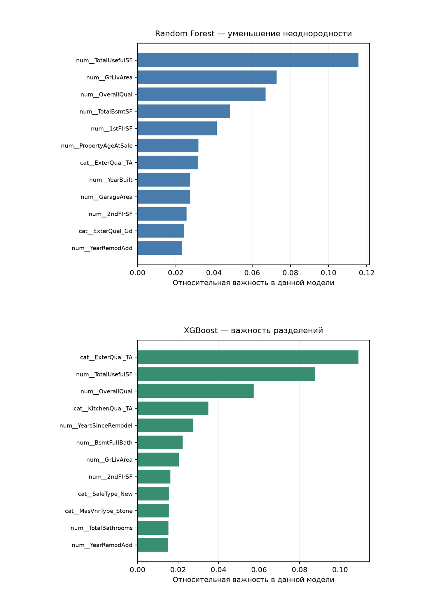

*Рисунок 5.2 - Относительная важность характеристик для Random Forest и XGBoost в определении ценового сегмента.*

Для бинарной классификации модель определяет, относится ли дом к сегменту стоимости от 200 000 USD. Рейтинг признаков может отличаться от регрессионного, поскольку алгоритмы решают различные задачи. Сравнение показывает, какие характеристики чаще используются моделями в задачах прогноза цены и выделения дорогого сегмента. Оно не устанавливает причинную значимость признаков.

<details>
<summary>Код ячейки 11</summary>

```python
rf_c = pd.read_csv(RESULTS / "importance_classification_random_forest.csv")
xgb_c = pd.read_csv(RESULTS / "importance_classification_xgboost.csv")
display(xgb_c.head(10))
```

</details>

|  | Feature | Importance |
| --- | --- | --- |
| 0 | cat__ExterQual_TA | 0.109041 |
| 1 | num__TotalUsefulSF | 0.087710 |
| 2 | num__OverallQual | 0.057311 |
| 3 | cat__KitchenQual_TA | 0.034986 |
| 4 | num__YearsSinceRemodel | 0.027614 |
| 5 | num__BsmtFullBath | 0.022271 |
| 6 | num__GrLivArea | 0.020357 |
| 7 | num__2ndFlrSF | 0.016242 |
| 8 | cat__SaleType_New | 0.015412 |
| 9 | cat__MasVnrType_Stone | 0.015372 |

**Общий вывод по рисункам 5.1 и 5.2.** Встроенная важность характеризует использование признаков моделями, но не показывает, повышает или понижает конкретная характеристика прогноз отдельного дома. Для изучения направления и величины модельного вклада далее используется SHAP.

### Глобальный SHAP-анализ стоимости

<details>
<summary>Код ячейки 14</summary>

```python
display(Image(filename=str(RESULTS / "figures" / "5_3_shap_beeswarm_regression.png")))
```

</details>

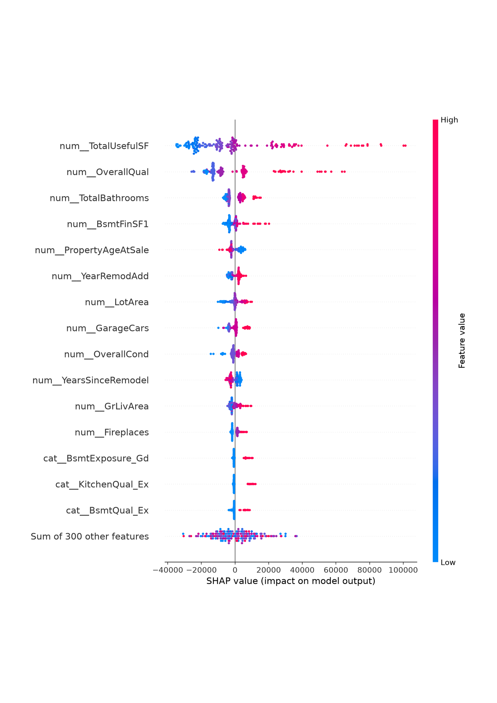

*Рисунок 5.3 - SHAP Summary Plot для прогноза стоимости (диаграмма распределения вкладов).*

Каждая точка соответствует одному дому, положение по горизонтали показывает, насколько соответствующий признак повышает или понижает прогноз в долларах относительно базового уровня. Цвет отражает значение преобразованного признака, а не цену дома. Значения числовых признаков стандартизированы, а категориальные представлены индикаторами One-Hot. Точки справа повышают прогноз, слева - снижают его.

<details>
<summary>Код ячейки 16</summary>

```python
display(Image(filename=str(RESULTS / "figures" / "5_4_shap_bar_regression.png")))
```

</details>

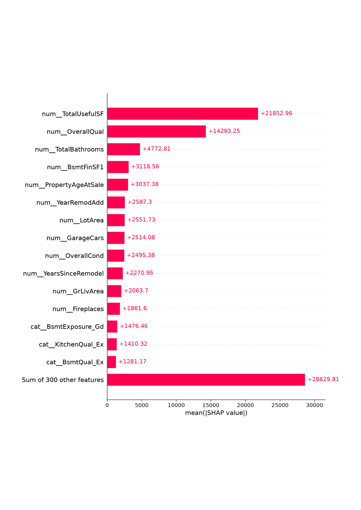

*Рисунок 5.4 - Средние абсолютные SHAP-вклады признаков в регрессионных прогнозах.*

Диаграмма показывает среднюю абсолютную величину модельных SHAP-вкладов **без учёта знака**. Поэтому она подходит для ранжирования глобальной важности, но не позволяет сказать, увеличивает ли признак цену. Вместе с рисунком 5.3 она позволяет сопоставить силу и направление вкладов. Результат рассчитан на подвыборке внешнего теста, а не на всех домах исходного набора.

<details>
<summary>Код ячейки 18</summary>

```python
display(pd.read_csv(RESULTS / "shap_global_regression.csv").head(12))
```

</details>

|  | Feature | MeanAbsSHAP |
| --- | --- | --- |
| 0 | num__TotalUsefulSF | 21852.9550 |
| 1 | num__OverallQual | 14293.2540 |
| 2 | num__TotalBathrooms | 4772.8086 |
| 3 | num__BsmtFinSF1 | 3118.5570 |
| 4 | num__PropertyAgeAtSale | 3037.3774 |
| 5 | num__YearRemodAdd | 2587.2976 |
| 6 | num__LotArea | 2551.7341 |
| 7 | num__GarageCars | 2514.0780 |
| 8 | num__OverallCond | 2495.3840 |
| 9 | num__YearsSinceRemodel | 2270.9453 |
| 10 | num__GrLivArea | 2063.6968 |
| 11 | num__Fireplaces | 1861.5988 |

### Локальное объяснение стоимости отдельного дома

<details>
<summary>Код ячейки 20</summary>

```python
print(f"Id объекта: {local_reg['Id']}")
print(f"Фактическая цена: ${local_reg['Actual']:,.2f}")
print(f"Прогноз XGBoost: ${local_reg['Pred_USD']:,.2f}")
display(Image(filename=str(RESULTS / "figures" / "5_5_shap_waterfall_regression.png")))
```

</details>

```text
Id объекта: 1424
Фактическая цена: $274,970.00
Прогноз XGBoost: $160,275.66
```

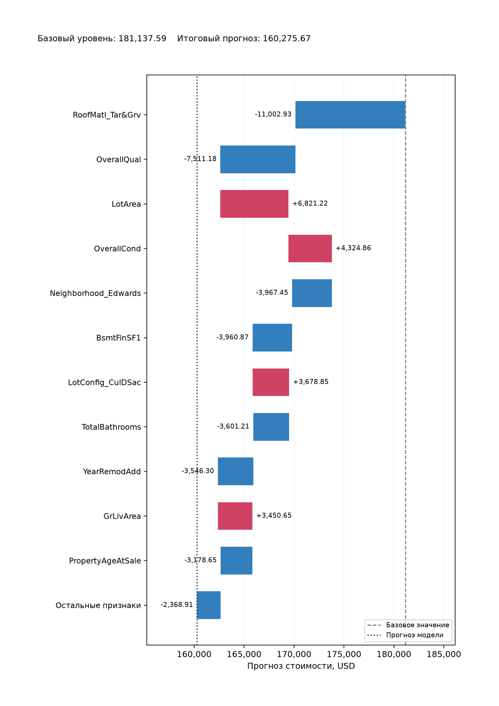

*Рисунок 5.5 - Разложение прогноза отдельного дома по SHAP (Waterfall Plot, каскадная диаграмма).*

За базовый уровень принимается значение модели, а стрелки и полосы показывают, как отдельные характеристики изменили итоговый прогноз. Сумма всех вкладов и базового значения точно восстанавливает прогноз XGBoost. Для выбранного дома отдельно полезно сопоставить категорию качества бассейна с фактическим использованием этого признака моделью: нулевой вклад не означает, что наличие бассейна не влияет на рыночную стоимость вообще.

<details>
<summary>Код ячейки 22</summary>

```python
display(pd.read_csv(RESULTS / "local_regression.csv").head(12))
show_force_plot_button("force_regression.html", "Force Plot — стоимость")
```

</details>

|  | Feature | FeatureValueScaled | SHAP |
| --- | --- | --- | --- |
| 0 | cat__RoofMatl_Tar&Grv | 1.000000 | -11002.9300 |
| 1 | num__OverallQual | -0.074699 | -7511.1810 |
| 2 | num__LotArea | 2.253476 | 6821.2220 |
| 3 | num__OverallCond | 1.245799 | 4324.8620 |
| 4 | cat__Neighborhood_Edwards | 1.000000 | -3967.4463 |
| 5 | num__BsmtFinSF1 | -0.963901 | -3960.8696 |
| 6 | cat__LotConfig_CulDSac | 1.000000 | 3678.8486 |
| 7 | num__TotalBathrooms | -0.269307 | -3601.2114 |
| 8 | num__YearRemodAdd | -0.925245 | -3546.3050 |
| 9 | num__GrLivArea | 1.436324 | 3450.6482 |
| 10 | num__PropertyAgeAtSale | 0.107995 | -3178.6520 |
| 11 | num__YearsSinceRemodel | 0.835403 | -3066.2180 |

```text
VBox(children=(Button(description='Force Plot — стоимость', icon='external-link', layout=Layout(width='auto'),…
```

### Глобальный SHAP-анализ ценового сегмента

<details>
<summary>Код ячейки 24</summary>

```python
display(Image(filename=str(RESULTS / "figures" / "5_6_shap_beeswarm_classification.png")))
```

</details>

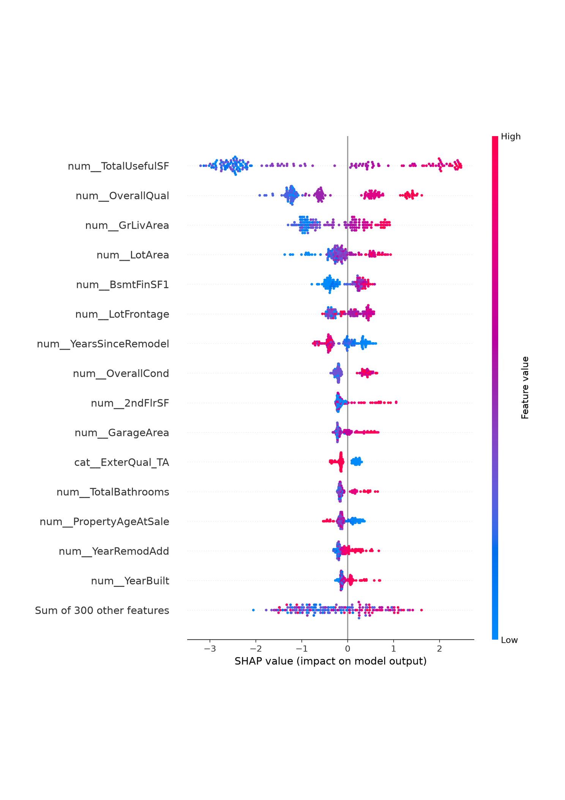

*Рисунок 5.6 - SHAP Summary Plot для классификации ценового сегмента.*

Положительные SHAP-вклады увеличивают **логарифм отношения шансов** принадлежности дому к дорогому сегменту, отрицательные - уменьшают его. Их нельзя читать как изменение вероятности в процентных пунктах. Цвет точек отражает значения признаков после предобработки. Изменение вероятности зависит также от базового значения и остальных вкладов.

<details>
<summary>Код ячейки 26</summary>

```python
display(Image(filename=str(RESULTS / "figures" / "5_7_shap_bar_classification.png")))
```

</details>

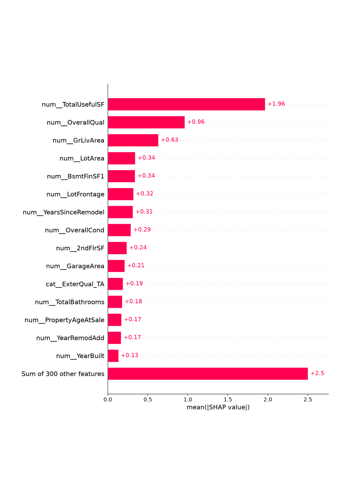

*Рисунок 5.7 - Средние абсолютные SHAP-вклады признаков при определении ценового сегмента.*

Рисунок отражает среднюю величину вкладов на логарифмической шкале шансов без учёта их направления. Он позволяет сравнить характеристики по значимости в рамках классификатора XGBoost. Сопоставление рисунков 5.6 и 5.7 выявляет как общую важность, так и разницу между высокими и низкими значениями признаков.

<details>
<summary>Код ячейки 28</summary>

```python
display(pd.read_csv(RESULTS / "shap_global_classification.csv").head(12))
```

</details>

|  | Feature | MeanAbsSHAP |
| --- | --- | --- |
| 0 | num__TotalUsefulSF | 1.964509 |
| 1 | num__OverallQual | 0.961142 |
| 2 | num__GrLivArea | 0.632224 |
| 3 | num__LotArea | 0.342200 |
| 4 | num__BsmtFinSF1 | 0.340364 |
| 5 | num__LotFrontage | 0.319953 |
| 6 | num__YearsSinceRemodel | 0.314180 |
| 7 | num__OverallCond | 0.288079 |
| 8 | num__2ndFlrSF | 0.236957 |
| 9 | num__GarageArea | 0.210709 |
| 10 | cat__ExterQual_TA | 0.189107 |
| 11 | num__TotalBathrooms | 0.179638 |

### Локальное объяснение принадлежности к ценовому сегменту

<details>
<summary>Код ячейки 30</summary>

```python
print(f"Id объекта: {local_clf['Id']}")
print(f"Фактический класс: {local_clf['Actual']}")
print(f"Вероятность класса 1: {local_clf['ProbabilityClass1']:.1%}")
display(Image(filename=str(RESULTS / "figures" / "5_8_shap_waterfall_classification.png")))
```

</details>

```text
Id объекта: 1051
Фактический класс: 0
Вероятность класса 1: 52.1%
```

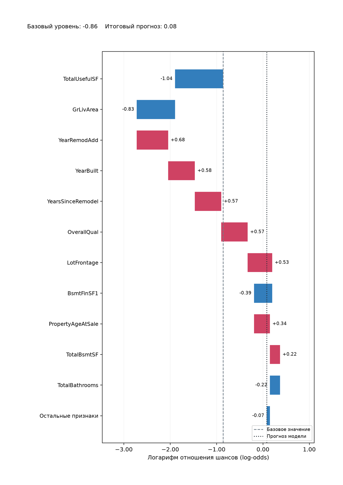

*Рисунок 5.8 - Разложение классификационного прогноза XGBoost по SHAP.*

Каждый признак добавляет вклад к базовому значению на шкале log-odds (логарифма отношения шансов). Суммарное значение преобразуется логистической функцией в итоговую вероятность принадлежности объекта к классу `1`. В диаграмме допускаются как положительные, так и отрицательные вклады, однако они отражают **работу модели**, а не причинное изменение цены объекта.

<details>
<summary>Код ячейки 32</summary>

```python
display(pd.read_csv(RESULTS / "local_classification.csv").head(12))
show_force_plot_button("force_classification.html", "Force Plot — классификация")
```

</details>

|  | Feature | FeatureValueScaled | SHAP |
| --- | --- | --- | --- |
| 0 | num__TotalUsefulSF | 0.061602 | -1.035633 |
| 1 | num__GrLivArea | -0.412540 | -0.827208 |
| 2 | num__YearRemodAdd | 1.067565 | 0.676683 |
| 3 | num__YearBuilt | 1.184962 | 0.577193 |
| 4 | num__YearsSinceRemodel | -1.109002 | 0.568604 |
| 5 | num__OverallQual | 0.646362 | 0.568114 |
| 6 | num__LotFrontage | 0.157045 | 0.529244 |
| 7 | num__BsmtFinSF1 | -0.963901 | -0.391640 |
| 8 | num__PropertyAgeAtSale | -1.211101 | 0.342434 |
| 9 | num__TotalBsmtSF | 0.621853 | 0.217745 |
| 10 | num__TotalBathrooms | -0.269307 | -0.217618 |
| 11 | num__GarageArea | -0.177143 | -0.202493 |

```text
VBox(children=(Button(description='Force Plot — классификация', icon='external-link', layout=Layout(width='aut…
```

### Дополнительное сравнение SHAP для Random Forest и XGBoost

Сравнение средней абсолютной величины SHAP-вкладов разных алгоритмов имеет смысл только для одной задачи, одинаковых объектов и одной шкалы прогноза. Для регрессии обе модели дают значения в долларах. Вычисление этого дополнения не входит в основной запуск и выполняется отдельно с параметром `--compare-rf-shap`.

<details>
<summary>Код ячейки 34</summary>

```python
extra = RESULTS / "figures" / "5_9_shap_rf_xgb_regression.png"
if extra.exists():
    display(Image(filename=str(extra)))
    display(pd.read_csv(RESULTS / "shap_compare_rf_xgb_regression.csv").head(12))
else:
    print("Дополнительный анализ не выполнялся. Команда: python main.py explainability --compare-rf-shap")
```

</details>

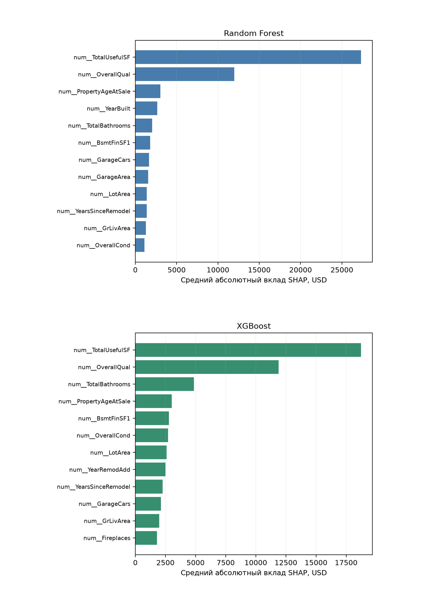

|  | Feature | RF_MeanAbsSHAP_USD | XGBoost_MeanAbsSHAP_USD |
| --- | --- | --- | --- |
| 0 | num__TotalUsefulSF | 27311.592908 | 18731.2030 |
| 1 | num__OverallQual | 11957.566114 | 11884.7470 |
| 2 | num__TotalBathrooms | 2045.250349 | 4861.2720 |
| 3 | num__PropertyAgeAtSale | 3043.745239 | 3020.1704 |
| 4 | num__BsmtFinSF1 | 1791.478547 | 2787.9014 |
| 5 | num__OverallCond | 1085.736788 | 2705.6970 |
| 6 | num__LotArea | 1391.211178 | 2591.1907 |
| 7 | num__YearRemodAdd | 1003.365424 | 2512.8904 |
| 8 | num__YearsSinceRemodel | 1388.546711 | 2275.9690 |
| 9 | num__GarageCars | 1636.358449 | 2124.9429 |
| 10 | num__GrLivArea | 1284.061716 | 1988.9342 |
| 11 | num__Fireplaces | 428.789696 | 1792.0592 |

Если рисунок 5.9 построен, он показывает среднюю величину модельных SHAP-вкладов для Random Forest и XGBoost при регрессии. Различия отражают способы использования признаков конкретными моделями, но сами по себе не объясняют различия их точности и не доказывают причинную значимость признаков.

### Итоговые выводы

В исследовании сопоставлена встроенная важность признаков двух ансамблевых алгоритмов - случайного леса и градиентного бустинга XGBoost - для задач прогнозирования стоимости и классификации ценового сегмента. Результаты позволяют сравнить относительные рейтинги характеристик, но не указывают на прямой причинно-следственный эффект признаков.

SHAP-анализ дополнил глобальные показатели локальными объяснениями конкретных прогнозов. Для регрессии вклады интерпретируются в долларах США, для бинарной классификации XGBoost - в логарифме отношения шансов. Для рассмотренных объяснений проверена аддитивность. Сумма базового значения и вкладов воспроизводит прогноз модели на соответствующей шкале.

Отдельное внимание уделено дому с нетипичной характеристикой бассейна и объекту, расположенному около границы классификационного решения. Их интерпретация демонстрирует зависимость прогнозов от конкретных сочетаний признаков, но не используется как независимая проверка качества моделей.

Полученные объяснения ограничены обученными конфигурациями алгоритмов, выборкой объектов для SHAP и зависимостями между признаками. Эти ограничения необходимо учитывать при формулировании предметных выводов и дальнейшем использовании моделей.

## 6. Кластеризация недвижимости и поиск групп по характеристикам

Цель исследования - выявить группы недвижимости на основе сходства характеристик. Группы формируются **без использования фактической стоимости (`SalePrice`) и ценовой категории**. Эти величины привлекаются только после обучения для содержательной оценки найденных кластеров.

Основной метод - K-means (метод k-средних). Число групп определяется по коэффициенту силуэта (*Silhouette Score*) с ограничением на минимальный размер группы. Для представления структуры применяются PCA (анализ главных компонент) и дополнительно t-SNE, для альтернативного сравнения - DBSCAN (кластеризация по плотности).

Исследование выполняется на 1 168 домах из обучающей части исходного набора. Внешняя тестовая выборка не участвует в построении групп.

### Подготовка данных

Используются восемь содержательно интерпретируемых числовых характеристик - общее качество, состояние, суммарная площадь, количество санузлов, вместимость гаража, возраст, площадь участка и отделанная площадь подвала. Категориальные признаки OHE исключены из текущей постановки, чтобы не придавать чрезмерный вес редким категориям.

Числовые пропуски заполнены медианами, для отдельных характеристик ограничены экстремальные значения, затем выполнена стандартизация. Все преобразования обучены только на исследуемой обучающей части, без цен и внешнего теста.

<details>
<summary>Код ячейки 3</summary>

```python
from pathlib import Path
import sys
import pandas as pd
from IPython.display import Image, Markdown, display

ROOT = Path.cwd()
if ROOT.name == "notebooks":
    ROOT = ROOT.parent
if str(ROOT) not in sys.path:
    sys.path.insert(0, str(ROOT))

from house_prices_ai.clustering import CLUSTER_FEATURES, FRIENDLY

OUTPUT = ROOT / "outputs" / "clustering"
if not (OUTPUT / "cluster_k_selection.csv").is_file():
    raise FileNotFoundError("Сначала выполните: python main.py clustering --tsne --dbscan")

selection = pd.read_csv(OUTPUT / "cluster_k_selection.csv")
profiles = pd.read_csv(OUTPUT / "cluster_profiles.csv").sort_values("Cluster")
assignments = pd.read_csv(OUTPUT / "cluster_assignments.csv")
features_mean = pd.read_csv(OUTPUT / "cluster_mean_characteristics.csv")
selected_k = int(len(profiles))
best = selection.loc[selection["k"] == selected_k].iloc[0]

print(f"Число объектов: {len(assignments)}")
print(f"Признаков для группировки: {len(CLUSTER_FEATURES)}")
display(pd.DataFrame({
    "Характеристика": [FRIENDLY[name] for name in CLUSTER_FEATURES],
    "Признак": CLUSTER_FEATURES,
}))
```

</details>

```text
Число объектов: 1168
Признаков для группировки: 8
```

|  | Характеристика | Признак |
| --- | --- | --- |
| 0 | Общее качество | OverallQual |
| 1 | Общее состояние | OverallCond |
| 2 | Суммарная площадь | TotalUsefulSF |
| 3 | Санузлы (экв.) | TotalBathrooms |
| 4 | Вместимость гаража | GarageCars |
| 5 | Возраст дома | PropertyAgeAtSale |
| 6 | Площадь участка | LotArea |
| 7 | Отделанный подвал | BsmtFinSF1 |

Таблица 6.1 - восемь признаков, использованных для построения кластеров. Стоимость и ценовой класс в этот перечень не включены.

### Выбор числа кластеров

Инерция (*inertia*, сумма квадратов расстояний от объектов до центров групп) закономерно уменьшается при увеличении числа кластеров. Поэтому метод «локтя» используется как наглядный ориентир, но не как единственный критерий выбора.

Коэффициент силуэта (*Silhouette Score*) учитывает сходство объектов внутри своей группы и отличие от соседней группы. Чем выше значение, тем чётче геометрическое разделение. Проверены значения `k` от 2 до 8, а число кластеров выбиралось среди вариантов с размером каждой группы не менее 5% выборки.

<details>
<summary>Код ячейки 5</summary>

```python
display(selection.round(4))
print(f"Выбрано k = {selected_k}, коэффициент силуэта = {best['Silhouette']:.4f}")
print(f"Calinski–Harabasz = {best['CalinskiHarabasz']:.1f}, Davies–Bouldin = {best['DaviesBouldin']:.3f}")
```

</details>

|  | k | Inertia | Silhouette | CalinskiHarabasz | DaviesBouldin | MinClusterSize | MinClusterFraction |
| --- | --- | --- | --- | --- | --- | --- | --- |
| 0 | 2 | 6428.7595 | 0.2652 | 528.7444 | 1.4065 | 582 | 0.4983 |
| 1 | 3 | 5561.4950 | 0.2114 | 396.1751 | 1.5414 | 208 | 0.1781 |
| 2 | 4 | 4993.8348 | 0.1918 | 337.9896 | 1.6711 | 184 | 0.1575 |
| 3 | 5 | 4572.0856 | 0.1849 | 303.4576 | 1.6517 | 162 | 0.1387 |
| 4 | 6 | 4256.3169 | 0.1726 | 277.7936 | 1.5597 | 135 | 0.1156 |
| 5 | 7 | 4028.6333 | 0.1771 | 255.3033 | 1.5623 | 119 | 0.1019 |
| 6 | 8 | 3818.4580 | 0.1655 | 239.7987 | 1.5783 | 98 | 0.0839 |

```text
Выбрано k = 2, коэффициент силуэта = 0.2652
Calinski–Harabasz = 528.7, Davies–Bouldin = 1.407
```

<details>
<summary>Код ячейки 6</summary>

```python
display(Image(filename=str(OUTPUT / "figures" / "6_1_elbow.png"), width=650))
```

</details>

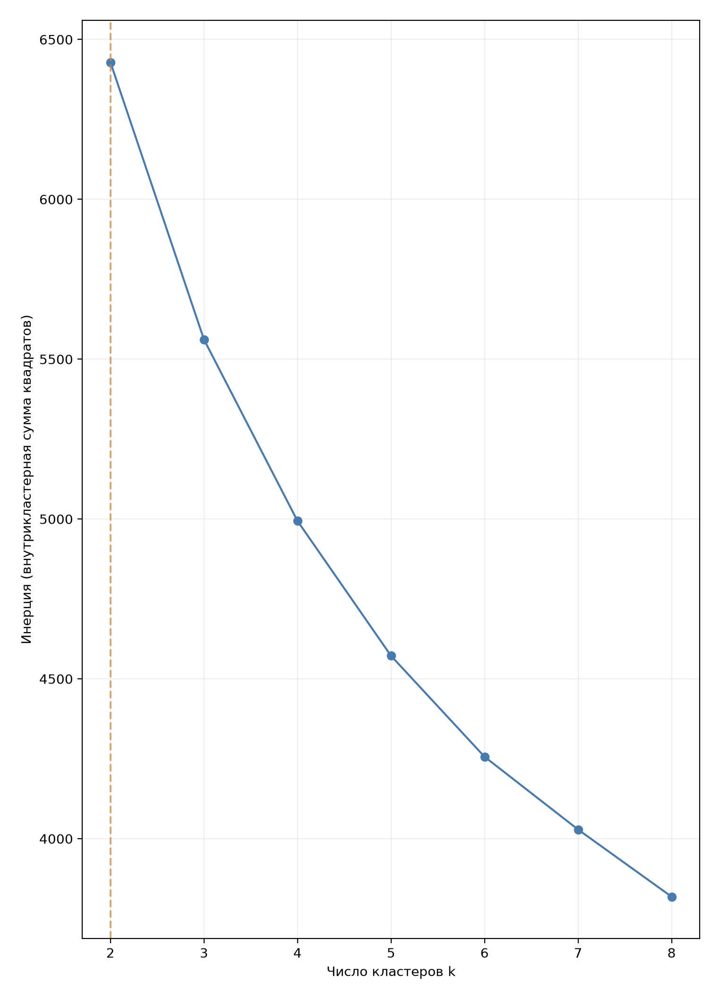

*Рисунок 6.1 - Зависимость инерции K-means от числа кластеров.*

Инерция монотонно снижается по мере увеличения числа центров, что является ожидаемым свойством K-means. Снижение инерции не означает автоматического улучшения содержательной интерпретируемости групп, поэтому выбор числа кластеров дополнительно проверяется по коэффициенту силуэта.

<details>
<summary>Код ячейки 8</summary>

```python
display(Image(filename=str(OUTPUT / "figures" / "6_2_silhouette.png"), width=650))
```

</details>

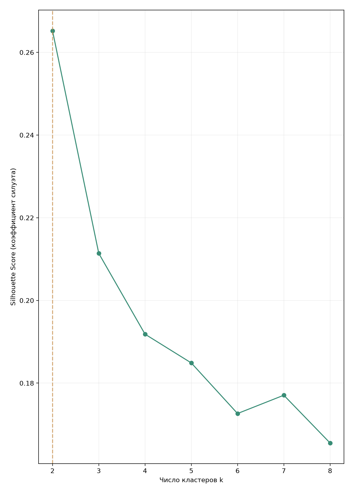

*Рисунок 6.2 - Коэффициент силуэта при различных значениях k.*

На исследуемых данных максимум коэффициента силуэта составляет **0,2652 при k = 2**. Для других проверенных значений k он ниже. Поэтому два кластера выбраны **среди проверенных конфигураций**. Невысокое значение силуэта указывает на ограниченную разделимость и частичное перекрытие групп.

Таким образом, для дальнейшего описательного анализа принято разделение на два кластера. Оно определяется исключительно характеристиками недвижимости, а не её стоимостью.

### Пространственное представление и профили групп

PCA (анализ главных компонент) переводит исходные восемь стандартизированных характеристик в двумерное представление, пригодное для графика. При этом **K-means обучался в исходном восьмимерном пространстве**. Поэтому двумерная проекция служит иллюстрацией, но не точным изображением всех расстояний между домами.

<details>
<summary>Код ячейки 11</summary>

```python
display(Image(filename=str(OUTPUT / "figures" / "6_3_clusters_pca.png"), width=650))
```

</details>

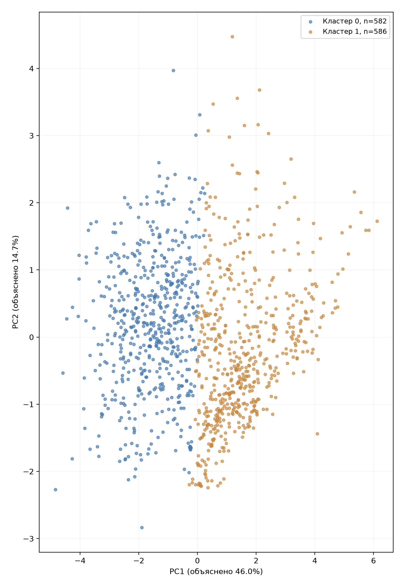

*Рисунок 6.3 - Двумерная PCA-проекция кластеров недвижимости.*

Первые две главные компоненты объясняют **60,7%** вариации восьми подготовленных характеристик. Группы различимы в проекции, однако частично перекрываются. Это согласуется с умеренным значением коэффициента силуэта и не является признаком неправильной работы алгоритма.

<details>
<summary>Код ячейки 13</summary>

```python
display(Image(filename=str(OUTPUT / "figures" / "6_4_cluster_profiles.png"), width=650))
```

</details>

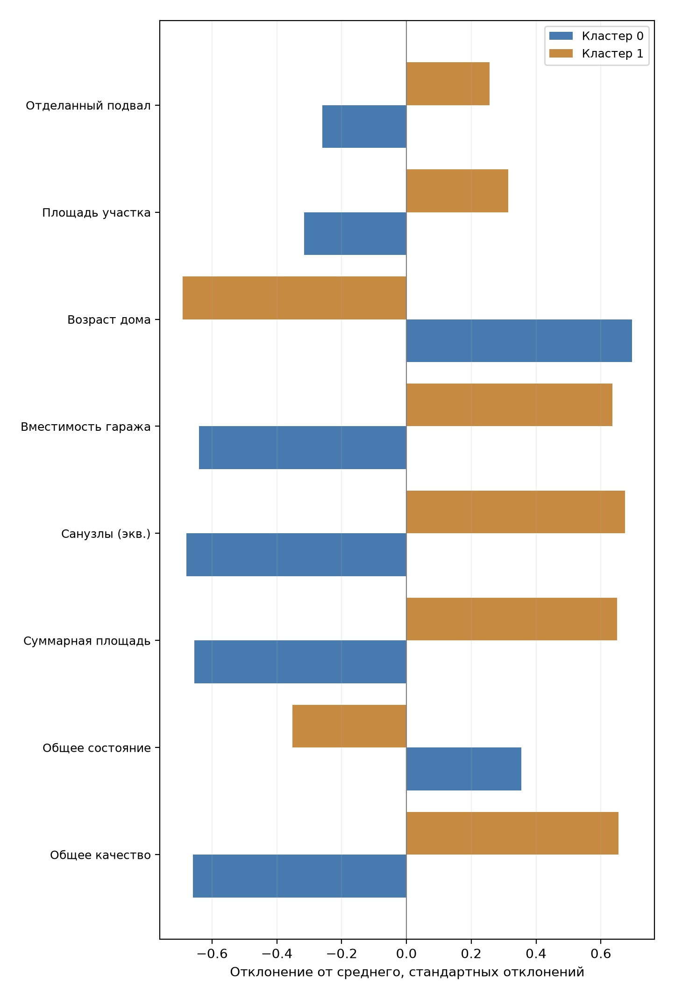

*Рисунок 6.4 - Сравнение стандартизированных характеристик кластеров.*

На графике показано, чем средние значения признаков внутри групп отличаются от среднего по обучающей выборке. Положительные значения означают превышение общего среднего, отрицательные - значения ниже среднего. Эти отклонения **не являются вкладом в стоимость недвижимости**. Характеристики групп следует читать совместно с таблицей в исходных единицах измерения.

<details>
<summary>Код ячейки 15</summary>

```python
display(features_mean.round(2))
```

</details>

|  | Cluster | OverallQual | OverallCond | TotalUsefulSF | TotalBathrooms | GarageCars | PropertyAgeAtSale | LotArea | BsmtFinSF1 |
| --- | --- | --- | --- | --- | --- | --- | --- | --- | --- |
| 0 | 0 | 5.19 | 6.0 | 2060.91 | 1.68 | 1.29 | 57.83 | 8500.13 | 331.19 |
| 1 | 1 | 7.01 | 5.2 | 3044.14 | 2.75 | 2.24 | 15.76 | 10787.00 | 557.28 |

По исходным характеристикам **кластер 0** объединяет более старые дома с меньшей суммарной площадью, менее высоким качеством и меньшей вместимостью гаража. **Кластер 1** содержит преимущественно более новые, просторные и качественные объекты. Таким образом, группы имеют содержательные различия, а не только математические номера.

Таблица 6.3 - средние значения восьми характеристик внутри найденных групп. Вместе с рисунком 6.4 она помогает описать их различия.

### Сопоставление групп с фактическими ценами

**Только после формирования кластеров** сопоставляем их с ценой продажи и бинарной ценовой категорией. Эти данные не использовались в K-means, поэтому такое сопоставление позволяет независимо описать экономические особенности найденных групп. Оно не является доказательством причинно-следственной связи.

<details>
<summary>Код ячейки 18</summary>

```python
display(profiles.round({
    "MeanPriceUSD": 0,
    "MedianPriceUSD": 0,
    "ExpensiveShare": 4,
    "MeanTotalUsefulSF": 0,
    "MeanOverallQual": 2,
    "MeanAge": 1,
}))
```

</details>

|  | Cluster | Count | MeanPriceUSD | MedianPriceUSD | ExpensiveShare | MeanTotalUsefulSF | MeanOverallQual | MeanAge |
| --- | --- | --- | --- | --- | --- | --- | --- | --- |
| 0 | 0 | 582 | 130345.0 | 131000.0 | 0.0309 | 2061.0 | 5.19 | 57.8 |
| 1 | 1 | 586 | 231729.0 | 210000.0 | 0.5631 | 3044.0 | 7.01 | 15.8 |

<details>
<summary>Код ячейки 19</summary>

```python
display(Image(filename=str(OUTPUT / "figures" / "6_5_price_by_cluster.png"), width=650))
```

</details>

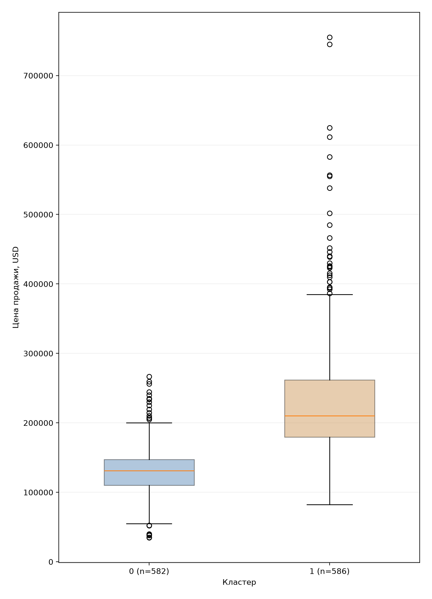

*Рисунок 6.5 - Распределение стоимости продажи в найденных кластерах.*

В кластере 0 медианная цена равна **131 000 USD**, средняя - **130 345 USD**. Для кластера 1 соответствующие значения составляют **210 000 USD** и **231 729 USD**. Таким образом, группы, сформированные без использования цены, различаются по распределению стоимости. При этом их ценовые диапазоны пересекаются. Диаграммы размаха дополнительно показывают пересечение диапазонов и наличие нетипично дорогих объектов.

<details>
<summary>Код ячейки 21</summary>

```python
display(Image(filename=str(OUTPUT / "figures" / "6_6_price_classes.png"), width=650))
```

</details>

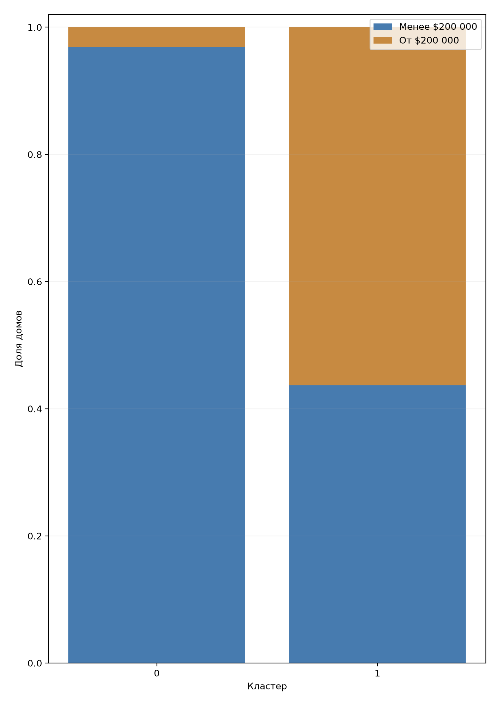

*Рисунок 6.6 - Доля домов разных ценовых сегментов внутри кластеров.*

Доля объектов со стоимостью от 200 000 USD составляет **3,1%** в кластере 0 и **56,3%** в кластере 1. Поскольку каждый столбец нормирован до 100%, сравнение не зависит от небольшой разницы в численности групп (582 и 586 домов).

Сопоставление рисунков 6.5 и 6.6 показывает, что более новые и просторные дома чаще относятся к дорогому ценовому сегменту. Однако разбиение на кластеры **не равно бинарной классификации по цене**: во втором кластере остаётся значительная доля домов дешевле 200 000 USD.

### Дополнительная проверка структуры: t-SNE и DBSCAN

t-SNE (стохастическое вложение соседей) используется для дополнительной двумерной визуализации локальных соседств. DBSCAN (кластеризация по плотности) ищет плотные группы и может отмечать нетипичные наблюдения как шум (`-1`). Эти методы работают по другим принципам, поэтому их результаты нельзя непосредственно приравнивать к K-means.

Следующие изображения создаются при запуске `python main.py clustering --tsne --dbscan`.

<details>
<summary>Код ячейки 24</summary>

```python
tsne_path = OUTPUT / "figures" / "6_7_clusters_tsne.png"
if tsne_path.is_file():
    display(Image(filename=str(tsne_path), width=650))
    display(Markdown("*Рисунок 6.7 - t-SNE-проекция кластеров K-means.*"))
else:
    print("Рисунок 6.7 не создан: используйте параметр --tsne.")
```

</details>

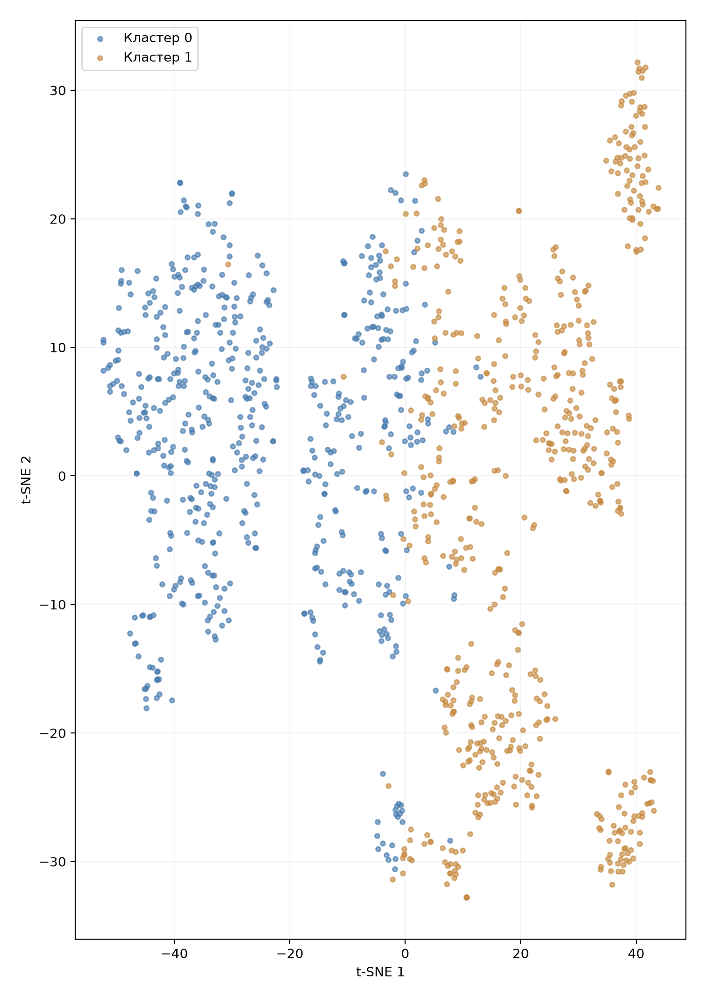

*Рисунок 6.7 - t-SNE-проекция кластеров K-means.*

На t-SNE отображается локальная структура соседств домов, найденных в восьмимерном пространстве. Форма и расстояние между отдельными визуальными «островами» сами по себе не доказывают качество кластеров. Поэтому вывод о предпочтительном k основан на исходных стандартизированных признаках, а не на t-SNE-проекции.

<details>
<summary>Код ячейки 26</summary>

```python
dbscan_path = OUTPUT / "figures" / "6_8_dbscan_pca.png"
if dbscan_path.is_file():
    display(Image(filename=str(dbscan_path), width=650))
    display(Markdown("*Рисунок 6.8 - Результат DBSCAN в PCA-проекции.*"))
else:
    print("Рисунок 6.8 не создан: используйте параметр --dbscan.")
```

</details>

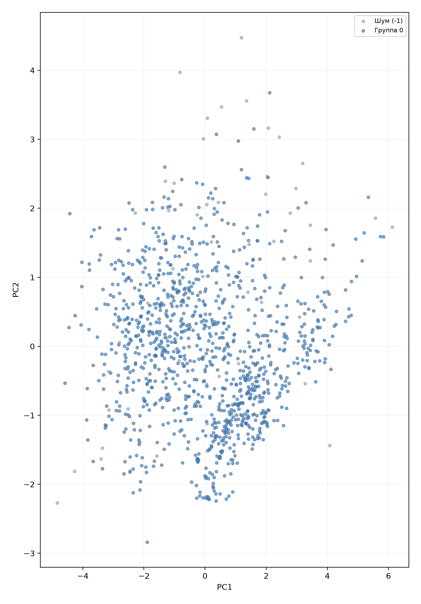

*Рисунок 6.8 - Результат DBSCAN в PCA-проекции.*

В дополнительных расчётах DBSCAN при `eps = 1,8` и `min_samples = 10` выделил **одну плотностную группу**, отнеся около **4,6%** наблюдений к шуму. Значение параметров не оптимизировалось, поэтому этот результат следует интерпретировать как ограниченный сравнительный эксперимент, а не как отрицательный вывод о применимости DBSCAN вообще.

### Итоговые выводы

В ходе исследования проведена кластеризация **1 168 исторических объектов недвижимости** по восьми содержательно выбранным и стандартизированным характеристикам. Фактическая стоимость, идентификатор и бинарный ценовой сегмент не участвовали в формировании групп. Количество кластеров K-means определено по коэффициенту силуэта среди значений `k = 2…8` с требованием минимальной численности каждой группы.

Наиболее предпочтительным вариантом оказалось **k = 2** при коэффициенте силуэта **0,2652**. Обнаруженные группы имеют близкую численность - **582** и **586** объектов. Невысокое значение силуэта указывает на ограниченную геометрическую разделимость и частичное перекрытие кластеров. Две компоненты PCA сохранили **60,7%** вариации исследуемых характеристик, поэтому визуальная проекция не исчерпывает многомерную структуру данных.

**Кластер 0** характеризуется более старой недвижимостью (средний возраст **57,8 года**), меньшей суммарной площадью (около **2 061 кв. фута**) и более низким уровнем качества (в среднем **5,19 балла**). В **кластере 1** средний возраст составляет **15,8 года**, суммарная площадь - около **3 044 кв. футов**, а качество - **7,01 балла**. Полученные различия позволяют интерпретировать кластеры как условные группы более старого и компактного жилья и более нового и просторного жилья.

Последующее, независимое от процедуры кластеризации сопоставление с ценами выявило существенную разницу: медианная стоимость составляет **131 000 USD** и **210 000 USD**, доля объектов стоимостью от **200 000 USD** - **3,1%** и **56,3%** соответственно. Результат указывает на описательную связь характеристик кластеров с распределением цен. Вместе с тем группы не совпадают полностью с ценовыми сегментами, а установленные различия носят описательный, а не причинный характер.

Дополнительная визуализация t-SNE подтверждает возможность представить локальные соседства объектов в двух измерениях. DBSCAN при выбранных параметрах сформировал одну группу и пометил около **4,6%** объектов как шум. Этот результат не является основанием для окончательного сравнения алгоритмов, поскольку настройки DBSCAN отдельно не оптимизировались.

Полученные группы можно использовать для описательной сегментации недвижимости, предварительного сравнения объектов и выявления нетипичных домов. Однако полученные результаты **не подтверждают автоматически повышение точности регрессионных или классификационных моделей**. Проверка такой гипотезы потребовала бы отдельного сравнительного эксперимента, где предобработка и назначение кластеров выполняются только на обучающей части каждого валидационного разбиения.

Ограничениями исследования остаются выбор восьми признаков, евклидова метрика, способ стандартизации, обработка выбросов и умеренная разделимость групп. В последующей работе возможны сравнение других наборов характеристик, подбор параметров плотностных методов и проверка устойчивости кластеров при изменении исходной выборки.

## Заключение

В ходе исследования последовательно выполнены анализ исходных данных, построение преобразований признаков, сравнение регрессионных и классификационных алгоритмов, интерпретация предсказаний и кластеризация объектов недвижимости. Единое разбиение данных и обучение преобразований внутри валидационных фолдов позволяют уменьшить риск утечки информации при сравнении моделей.

Для задачи регрессии наиболее высокое качество среди испытанных базовых конфигураций по результатам пятифолдовой CV показал XGBoost. При этом средние ошибки не описывают все особенности прогнозирования, поскольку для отдельных дорогих и нетипичных домов сохраняются крупные отклонения. Для классификации показана необходимость совместного анализа F1, Precision, Recall, ROC-AUC и характера ошибок, а не выбора по одной доле правильных ответов.

SHAP и встроенная важность дополняют оценку качества объяснениями работы моделей, но не служат доказательством причинного влияния характеристик недвижимости. Кластеризация выделила две группы домов с различающимися профилями и распределениями цен. Невысокий коэффициент силуэта ограничивает утверждения об их разделимости.

Таким образом, проект демонстрирует комплексный подход к анализу недвижимости, в котором подготовка данных, воспроизводимость, сопоставление алгоритмов и корректная интерпретация результатов рассматриваются совместно. Перспективными направлениями дальнейшей работы являются независимая оценка настроенных конфигураций, проверка альтернатив обработки выбросов и признаков, а также исследование устойчивости кластеров на изменённых выборках.
